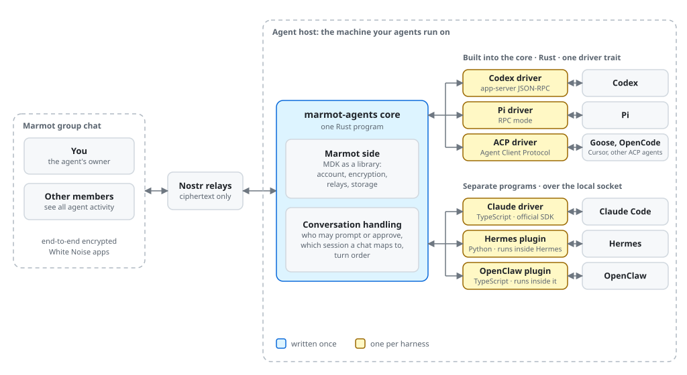

# marmot-agents

Connectors that put AI agents into [Marmot](https://github.com/marmot-protocol/marmot) group chats.

You run an agent harness such as Claude Code, Codex or Hermes on your own machine. This project connects it to an
end-to-end encrypted group, so you and the people you choose can talk to it from White Noise on your phone, see
what it is doing, approve what it asks, and control it as fully as you could at the terminal.

> **Status: the first code.** The design is in [`docs/`](docs/README.md). The code so far is a Rust workspace
> under [`crates/`](crates) with the list of item types; the Codex driver is being built first. Nothing here
> can be run yet.
> The connectors that ship today live in [MDK](https://github.com/marmot-protocol/mdk) under `integrations/`.

<picture>
  <source media="(prefers-color-scheme: dark)" srcset="docs/images/overview-dark.svg">
  
</picture>

## The idea in four sentences

1. Every harness is driven through its own richest interface, so nothing it can do is lost.
2. Each harness gets a small driver that translates its events into one shared set of Marmot events.
3. One core program handles everything that is the same for all harnesses: the Marmot account, who may talk to the
   agent, and which chat belongs to which session.
4. Harnesses that need another language connect to the core over a local socket.

## Where to go next

| You want | Read |
| --- | --- |
| The design in three minutes | [`docs/README.md`](docs/README.md) |
| What has been decided, and why | [`docs/decisions.md`](docs/decisions.md) |
| What is still open | [`docs/open-questions.md`](docs/open-questions.md) |
| How the parts fit together | [`docs/design/architecture.md`](docs/design/architecture.md) |
| Rules for coding agents working here | [`AGENTS.md`](AGENTS.md) |
