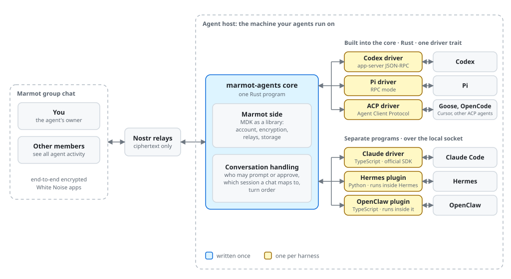
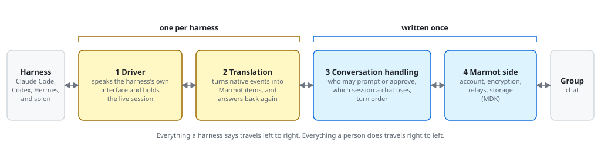
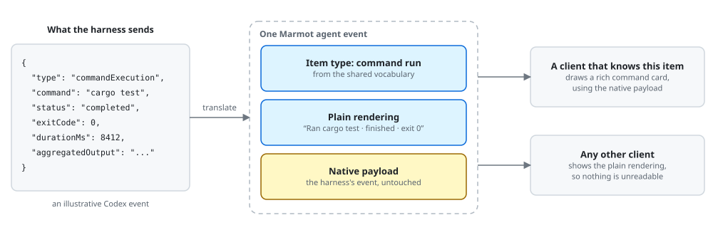

# The design in three minutes

This page is the starting point for the design. It says what the project does, how it is laid out, why it is laid
out that way, and where to look for more.

Status: the design is agreed in outline, and the core runs end to end with Codex ([how to try it](try.md)). Decided
points are in [`decisions.md`](decisions.md); everything else is a proposal until it lands there. What is built
next is in [`plan.md`](plan.md).

## What it does

A person runs an agent harness (Claude Code, Codex, Hermes and others) on a machine they control. This project
connects that harness to a Marmot group chat. People in the group can then:

- talk to the agent from White Noise;
- see what it is doing as it works: its reasoning, the tools it runs, the results, its plans;
- answer when it asks for approval or asks a question;
- control it: interrupt, steer it mid-task, start sessions, switch model or mode, run its slash commands.

The agent's owner decides who in the group may talk to it and who may approve its actions.

## How it is laid out

<picture>
  <source media="(prefers-color-scheme: dark)" srcset="images/overview-dark.svg">
  
</picture>

There is one **core program**, written in Rust. It is the agent's presence in the group: it holds the Marmot
account, encrypts and decrypts, and decides what to do with each message.

Each harness has a **driver**. A driver talks to one harness in that harness's own interface. Some drivers are
built into the core. Others are separate programs, because the harness's official interface exists only in
TypeScript or Python; those connect to the core over a **local socket**.

Four layers sit between a harness and the chat. Two are written per harness, two are written once.

<picture>
  <source media="(prefers-color-scheme: dark)" srcset="images/layers-dark.svg">
  
</picture>

## Why it is laid out this way

**Harnesses differ, so drivers are not shared.** Each harness has its own events, controls and quirks. Forcing
them through one common interface would keep only what they all have in common. A driver per harness keeps
everything.

**Clients cannot know every harness, so events are shared.** White Noise has to draw whatever arrives. So every
driver translates into one vocabulary of Marmot events: a message, a tool call, a plan, an approval request and
so on. Each event also carries a plain rendering and the harness's original data.

<picture>
  <source media="(prefers-color-scheme: dark)" srcset="images/event-dark.svg">
  
</picture>

**The rules about people are the same for every harness, so they live in one place.** Who may prompt, who may
approve, and which chat maps to which session do not depend on the harness. The core handles them once.

**Some harnesses force a language, so there is a socket.** Hermes plugins are Python. OpenClaw plugins and the
official Claude and Cursor SDKs are TypeScript. A local socket lets those run as their own programs and still use
the same core.

**A standard covers the long tail.** Many harnesses speak the Agent Client Protocol (ACP). One ACP driver gives
broad coverage cheaply; a harness gets its own driver only when it matters enough to justify one.

## Which harness uses what

| Harness | Driver | Runs |
| --- | --- | --- |
| Codex | Native, Rust | Inside the core |
| Pi | Native, Rust | Inside the core |
| Goose, OpenCode, other ACP agents | ACP, Rust | Inside the core |
| Claude Code | Native, TypeScript | Separate program, over the socket |
| Cursor | Native, TypeScript | Separate program, over the socket |
| Hermes | Its own plugin, Python | Inside Hermes, over the socket |
| OpenClaw | Its own plugin, TypeScript | Inside OpenClaw, over the socket |

Details and reasons are in [`design/drivers.md`](design/drivers.md).

## Where to look for what

| Question | Document |
| --- | --- |
| What is being built, and in what order? | [`plan.md`](plan.md) |
| How do I try what is built? | [`try.md`](try.md) |
| What have we decided, and why? | [`decisions.md`](decisions.md) |
| What is still undecided? | [`open-questions.md`](open-questions.md) |
| How do the parts work together, step by step? | [`design/architecture.md`](design/architecture.md) |
| What does an agent event contain? | [`design/event-model.md`](design/event-model.md) |
| How does an agent event travel, and how is an item updated? | [`design/event-carrier.md`](design/event-carrier.md) |
| What are the exact tags of kinds 1201 and 1202? | [`design/agent-kinds.md`](design/agent-kinds.md) |
| How does a person answer an agent, or control it? | [`design/answers-and-controls.md`](design/answers-and-controls.md) |
| What travels over the socket? | [`design/socket-protocol.md`](design/socket-protocol.md) |
| How is each harness driven, and how do I add one? | [`design/drivers.md`](design/drivers.md) |
| How does a chat show an agent's subagents? (a proposal) | [`design/subagents.md`](design/subagents.md) |
| What do today's connectors in MDK do? | [`reference/current-connectors.md`](reference/current-connectors.md) |
| What did we learn from other projects? | [`reference/prior-art.md`](reference/prior-art.md) |
| What interface does each harness offer? | [`reference/harness-interfaces.md`](reference/harness-interfaces.md) |
| What do Codex and Claude Code actually send? | [`reference/harness-messages.md`](reference/harness-messages.md) |
| What does Hermes hand a platform? | [`reference/hermes-messages.md`](reference/hermes-messages.md) |
| What does OpenClaw hand a channel plugin? | [`reference/openclaw-messages.md`](reference/openclaw-messages.md) |
| Can one program hold several agent identities? | [`reference/mdk-multiple-identities.md`](reference/mdk-multiple-identities.md) |
| Where are the recorded sessions, and how do I record more? | [`../fixtures/recordings`](../fixtures/recordings/README.md), [`../tools/record`](../tools/record/README.md) |
| Does the event model survive real sessions? | [`../tools/prototype`](../tools/prototype/README.md) |

The `design/` documents are meant to be read by people. The `reference/` documents are long and detailed; they
exist so that nobody, human or agent, has to redo the research behind a decision.

## Where the code will live

`crates/` holds four crates so far: `marmot-agent-events`, the agent event and its item types;
`marmot-agent-driver`, the trait a driver implements; `marmot-agent-codex`, the Codex driver; and
`marmot-agent`, the core, being built. `packages/` and `python/` do not exist yet. They
are the planned shape, so that the code lands in the right place. The core program is called `marmot-agent`
([D-050](decisions.md#d-050-the-core-program-is-called-marmot-agent)), and the Codex driver is built first
([D-052](decisions.md#d-052-the-codex-driver-is-built-first)).

| Path | Holds |
| --- | --- |
| `crates/` | The Rust core, the driver trait, and the Rust drivers (Codex, Pi, ACP) |
| `packages/` | TypeScript: the Claude and Cursor drivers, the OpenClaw plugin, a socket client |
| `python/` | The Hermes plugin |
| `docs/` | Design, decisions and reference |
| `fixtures/recordings/` | Real harness sessions, recorded message by message |
| `tools/record/` | The recorders, the scrubber and the structure inventory |
| `tools/prototype/` | A prototype that turns recordings into the proposed agent events |

## Diagrams

The diagrams on this page are generated by [`images/generate.py`](images/generate.py). To change one, edit the
script and run `python3 docs/images/generate.py`. Do not edit the SVG files by hand.
