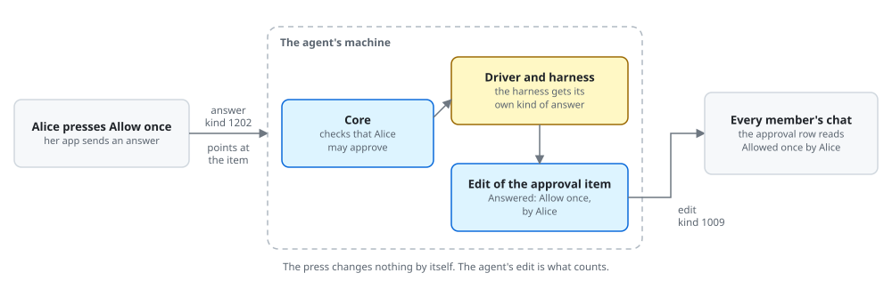

# Answers and controls

Status: decided on 2026-11-18, as [D-027](../decisions.md#d-027-answers-and-controls-are-one-kind-of-event-kind-1202)
to [D-032](../decisions.md#d-032-every-action-needs-one-of-two-rights), except which right each control needs
([Q-29](../open-questions.md#q-29-which-right-does-each-control-need)). None of it is in the Marmot specification yet,
and the exact tags are not fixed.

This is the second half of [how an agent event is carried](event-carrier.md): that page covers what an agent
sends to the chat, and this one covers what a person sends back.

## The two things a person sends

| | What it is | Examples |
| --- | --- | --- |
| **Answer** | A response to something the agent asked | "Allow once" on an approval. "Hello" on a question |
| **Control** | Something a person does unprompted | Interrupt. Switch model. Start a new session |

An ordinary chat message is neither. It is a prompt, and it stays a normal chat message.

## What it has to do

1. **Say exactly what it answers.** An approval must never be granted by a message meant for something else.
2. **Reach the right agent.** A group can hold more than one.
3. **Show everyone what happened.** In a group, every member sees who allowed what
   ([D-009](../decisions.md#d-009-groups-are-first-class-and-every-member-sees-agent-activity)).
4. **Stay true to each harness.** A harness offers its own models, modes and commands. The chat should offer
   those, not a list we invented ([D-008](../decisions.md#d-008-pass-everything-through)).
5. **Respect the owner's rules** about who may do what
   ([D-010](../decisions.md#d-010-the-owner-sets-who-may-prompt-and-who-may-approve)).

## What the recordings say

Read from the recordings of all four harnesses. See [`../reference/harness-messages.md`](../reference/harness-messages.md),
[`../reference/hermes-messages.md`](../reference/hermes-messages.md) and
[`../reference/openclaw-messages.md`](../reference/openclaw-messages.md).

| | Codex | Claude Code | Hermes | OpenClaw |
| --- | --- | --- | --- | --- |
| Answer an approval | A reply to a request, naming a decision | A reply to a callback: allow or deny | A call with a request id, or `/approve` | A call with an approval id, or `/approve <id>` |
| Answer a question | A reply with the chosen options | A reply through the approval callback | A chat message | Its own call with a question id. A chat message was not taken |
| Several questions in one request | Yes | Yes, and several selections each | No | No |
| Interrupt | A request | A call | The message `/stop` | The message `/stop` |
| Switch model | A field on the next turn | A call between turns | Not recorded | Not recorded |
| Switch mode | A field on the next turn | A setting | Not recorded | Not recorded |
| Compact | A request, which runs as its own turn | The message `/compact` | Not recorded | Not recorded |
| Slash commands | None in this interface | 59, sent as ordinary messages | Sent as ordinary messages | Sent as ordinary messages |

Three things follow:

- **Every harness names the request being answered.** All four give an approval an id. So an answer can always
  point at one exact item.
- **What can be set differs by harness.** There is no shared list of models or modes to build in.
- **Slash commands are already messages** in the three harnesses that have them.

## The design

### 1. One new kind carries both, kind 1202

An answer or a control is an event of kind 1202, sent by a person's app to the group. A tag says which action
it is ([D-027](../decisions.md#d-027-answers-and-controls-are-one-kind-of-event-kind-1202)).

Kind 1202 is reserved for agent events and has no definition in the specification. MDK today uses it for rows
an agent sends about its own operations. That use ends with the old connectors.

### 2. It names its agent, and what it acts on

| Part | Where | Example |
| --- | --- | --- |
| The plain rendering | `content` | `Allow once` |
| The agent it is for | a `p` tag, as mentions use | the agent's account |
| What it acts on | an `e` tag, as replies use | the approval item, or the turn to interrupt |
| The action | a tag | `answer`, `interrupt`, `set` |
| The action's details | a tag holding JSON | the choice's id; the setting and its new value |

An agent ignores an event that does not name it.

The `e` tag points at an item's first event, which is how an item is identified
([D-025](../decisions.md#d-025-an-agent-item-is-updated-with-an-edit)).

### 3. The agent's reply is what counts

<picture>
  <source media="(prefers-color-scheme: dark)" srcset="../images/answer-dark.svg">
  
</picture>

Sending an answer or a control changes nothing by itself. It is a request. The agent resolves each one with
exactly one event that points back at it ([D-028](../decisions.md#d-028-an-answer-or-a-control-is-a-request-and-the-agents-reply-settles-it)):

- **If it had an effect, the edit that shows the effect.** The approval item becomes "Answered: Allow once, by
  Alice". The turn becomes "Interrupted by Alice". The session's settings show the new model.
- **If it had none, a notice that says why**: not allowed, not supported by this harness, nothing to act on,
  already answered, or failed.

So there is one place to look for the truth: the agent's own items. An app shows a press as pending until the
agent's reply arrives. If the agent's machine is off, the press stays pending and nothing is assumed.

An answer or a control is not a row in the chat, does not alert anyone, and does not count as unread.

### 4. Rules for answers

Carried over from the earlier approvals design, MDK issue 858 and Marmot pull request 503. That design also
required an acknowledgement that harnesses do not give, and that part is dropped.

- **An answer counts only if it points at the exact item** and comes from someone allowed to give it.
- **Ordinary text is never an answer to an approval.** "Yes" or "go ahead" in the chat is a prompt.
- **An answer never reaches the model as a prompt.** It goes to the harness's own answer call.
- **An item is answered once.** The first valid answer the agent receives wins. Later ones get the notice
  "already answered".
- **The agent never answers for anyone**
  ([D-021](../decisions.md#d-021-approval-behaviour-belongs-to-the-harness)).

Added here:

- **An answer names choices by the ids the item offered.** A question that allows free text takes text as well.
- **One answer can cover several questions.** Codex and Claude Code both put several questions in one request.
- **An answer for an item that is no longer waiting has no effect.** The harness may have expired the request,
  or the turn may have ended.

Two exceptions stay, because the evidence forces them.

- **A question that is answered by a message.** A question whose `answer_via` is `message` has nothing to
  answer: the harness simply waits for the person's next message. Codex does this outside plan mode, and Hermes
  always. For such a question the reply is an ordinary chat message.
- **A gateway that takes an approval as text.** Hermes accepts `/approve` and `/deny` as chat messages, and
  OpenClaw accepts `/approve` with an id. A typed message is a prompt, so without a rule, someone who may prompt
  and may not approve could approve by typing. The rule: a connector lists the commands that need the right to
  approve, and the core checks a message starting with one of them against that right
  ([D-032](../decisions.md#d-032-every-action-needs-one-of-two-rights)). A command that changes the permission mode
  belongs on that list too.

### 5. Controls: a few shared ones, and whatever the harness offers

Only three actions mean the same thing everywhere ([D-029](../decisions.md#d-029-three-shared-controls-and-the-rest-comes-from-the-harness)):

| Action | What it does | Acts on |
| --- | --- | --- |
| `interrupt` | Stops the running turn | The turn |
| `new_session` | Ends this chat's session and starts a fresh one | The session |
| `set` | Changes one setting of the session | The session |

Everything else comes from the harness. Each driver publishes, per session:

- **Settings**: each with an id, a label, its current value and the values it accepts. Model and mode are
  settings. So is a harness's permission mode, which is how a chat changes it
  ([D-021](../decisions.md#d-021-approval-behaviour-belongs-to-the-harness)).
- **Actions** of its own: each with an id, a label and a description. Compacting is one.
- **Slash commands**: each with a name, a description and a hint, so an app can complete them as someone types.

An app draws its controls from that list. Nothing in an app or in the core checks a harness's name.

### 6. Where that list lives: a session item

The list has to be in the chat, so that an app has it before anyone presses anything, and has the last known
one when the agent's machine is off.

It is an eleventh item type, `session` ([D-030](../decisions.md#d-030-a-session-is-an-item-the-eleventh-type)). An agent
sends one when a session starts in a chat, and edits it when a setting changes or the session ends. It carries
the harness and its version, the session's id, and the three lists above.

This changed [the event model](event-model.md), which had ten types. It fits the evidence: Claude Code opens
every session with a message that lists its model, permission mode and slash commands, and Codex reports a
thread's settings.

The alternative was a `notice` of a new kind. A notice is a line of information for people. This list changes
over time, and an app has to find it by its type.

### 7. A slash command is a message

A message that starts with a slash is passed to the harness exactly as typed
([D-031](../decisions.md#d-031-a-slash-command-is-a-message-for-the-harness)). It is the harness's command, and three of the four
harnesses already take commands as messages.

The core has no typed commands of its own. Its controls are events of kind 1202, which an app sends from a
button or a menu. An app may also let someone type a control, but what it sends is still the event.

A harness has many commands of its own; Claude Code alone advertises 59. The core's controls cannot collide
with them, because one is text and the other is not.

The cost: a Marmot client with no support for agents can prompt an agent and use its slash commands, and cannot
approve, interrupt or change settings.

### 8. A message sent during a turn is still a message

Steering is not a control. A chat message that arrives while a turn is running is a prompt like any other. What
happens to it depends on the harness: Codex can fold it into the running turn, Hermes does so by itself, Claude
Code ends the turn and starts another, and OpenClaw holds it until the turn ends. Who decides that is
[Q-09](../open-questions.md#q-09-who-owns-the-queue-when-a-message-arrives-mid-turn), and this page does not
settle it.

### 9. Who may send what

[D-010](../decisions.md#d-010-the-owner-sets-who-may-prompt-and-who-may-approve) gives the owner two rights to
hand out: who may prompt, and who may approve. Both default to the owner alone. Every action needs one of them,
and there is no third right ([D-032](../decisions.md#d-032-every-action-needs-one-of-two-rights)).

Decided:

| Action | Right needed | Why |
| --- | --- | --- |
| Send a prompt or a slash command | Prompt | Except a command on the connector's list, which needs the right to approve |
| Answer an approval | Approve | |
| Change the permission mode | Approve | It decides what the agent may do without asking, so it is a standing approval |

Proposed, and not settled ([Q-29](../open-questions.md#q-29-which-right-does-each-control-need)):

| Action | Right proposed | Why |
| --- | --- | --- |
| Answer a question | Prompt | The answer is information for the agent, like a prompt |
| Interrupt | Prompt | Anyone who can start work can stop it |
| Start a new session | Prompt | |
| Change another setting, or use a harness's own action | Prompt | |

D-010 as written puts "use controls" with the right to approve, so the second table would change it. The
reason to change it: a harness's slash commands are messages, and they include commands that stop a turn, start
a session and switch the model. Someone who may prompt can type those. A stricter rule for the button than for
the typed command would protect nothing.

Someone without the right gets the "not allowed" notice, which is the refusal D-010 asks for.

### 10. Late and repeated events

An answer or a control can arrive long after it was sent, for example when the agent's machine was off.

- **One that points at an item acts only if that item is still live.** A late "interrupt" for a turn that has
  ended does nothing. A late answer to an expired approval does nothing.
- **One that points at nothing is dropped if it is old.** A "new session" sent an hour ago should not act when
  the machine comes back. The limit is five minutes. That is a first value with no evidence behind it.
- **Each event acts at most once.** The agent remembers the ids it has resolved.

## What is visible, and to whom

Answers and controls are group events. Every member's device receives them and keeps them. That is intended:
a group should see who approved a command.

It is a problem for one case. Codex can mark a question's answer as secret, such as a password. An answer sent
to a group is readable by every member, whatever the agent then does with it. This page does not solve that. It
is [Q-21](../open-questions.md#q-21-what-happens-to-a-secret-answer).

## What older apps show

An app built on today's MDK shows a kind 1202 event as a generic agent row. So a press from an updated app
would appear there as a small row, such as "Allow once". An app that hides unknown kinds shows nothing.

## Options considered

| Option | Why not |
| --- | --- |
| Send answers and controls as chat messages with a tag | They would alert people, show as chat in every client, and could reach the model as a prompt by mistake |
| A reaction on the approval item as the answer | It cannot carry text or several choices, and any member's reaction looks the same as the owner's |
| A typed command for everything, such as `/approve` | It collides with the harness's own commands, and a typo approves nothing or the wrong thing |
| A shared list of models and modes | Each harness has its own, and they change with every release |
| A separate kind for answers and for controls | They share one shape: who it is for, what it acts on, an action and its details |
| The app decides whether an answer was accepted | Two people can answer at once. Only the agent knows which one the harness took |

## What it needs from the spec and from MDK

In the Marmot specification:

- kind 1202: its tags, the actions, and what a client that does not support it should do;
- the `session` item.

In MDK:

- build answers and controls, and expose that to the apps;
- give the apps each item's choices, and each session's settings, actions and commands;
- show a press as pending until the agent's reply arrives;
- keep kind 1202 out of the chat's rows, alerts and unread counts.

In the core:

- check who sent it against the owner's rules;
- pass it to the driver, and turn the driver's result into the edit or the notice.

## Not covered here

- **What happens to a message sent during a turn**
  ([Q-09](../open-questions.md#q-09-who-owns-the-queue-when-a-message-arrives-mid-turn)).
- **Secret answers** ([Q-21](../open-questions.md#q-21-what-happens-to-a-secret-answer)).
- **Choosing among past sessions.** "New session" is here. Listing and resuming older ones depends on how a
  chat maps to a session ([Q-07](../open-questions.md#q-07-how-does-a-chat-map-to-a-harness-session)).
- **Changing who may prompt and approve from the chat**
  ([Q-10](../open-questions.md#q-10-how-are-permissions-changed-from-the-chat)).

## What was decided

| Point | Decision |
| --- | --- |
| Answers and controls are one kind, 1202, naming the agent and the item they act on | [D-027](../decisions.md#d-027-answers-and-controls-are-one-kind-of-event-kind-1202) |
| The agent's reply settles each one. The rules for answers. Late and repeated events, with a limit of five minutes | [D-028](../decisions.md#d-028-an-answer-or-a-control-is-a-request-and-the-agents-reply-settles-it) |
| Three shared controls, and everything else published by the driver | [D-029](../decisions.md#d-029-three-shared-controls-and-the-rest-comes-from-the-harness) |
| The list is carried by a `session` item, an eleventh type | [D-030](../decisions.md#d-030-a-session-is-an-item-the-eleventh-type) |
| A slash command is always a message for the harness | [D-031](../decisions.md#d-031-a-slash-command-is-a-message-for-the-harness) |
| Every action needs one of two rights | [D-032](../decisions.md#d-032-every-action-needs-one-of-two-rights) |

Still open on this page: which right each control needs ([Q-29](../open-questions.md#q-29-which-right-does-each-control-need)).
