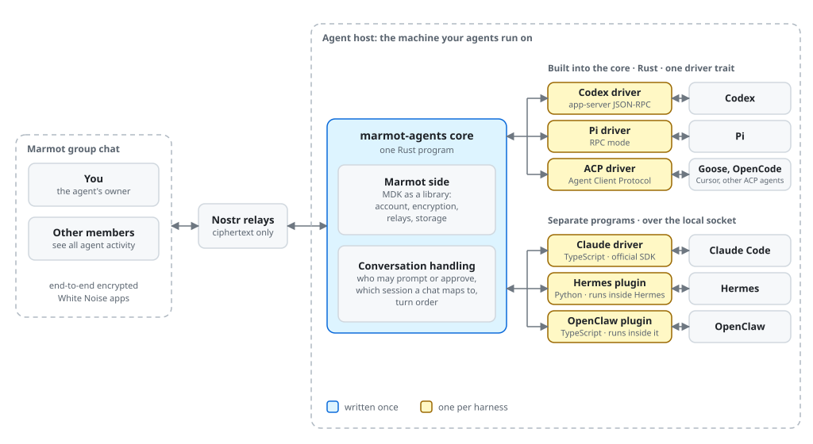
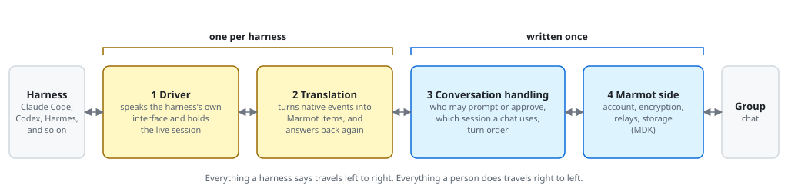
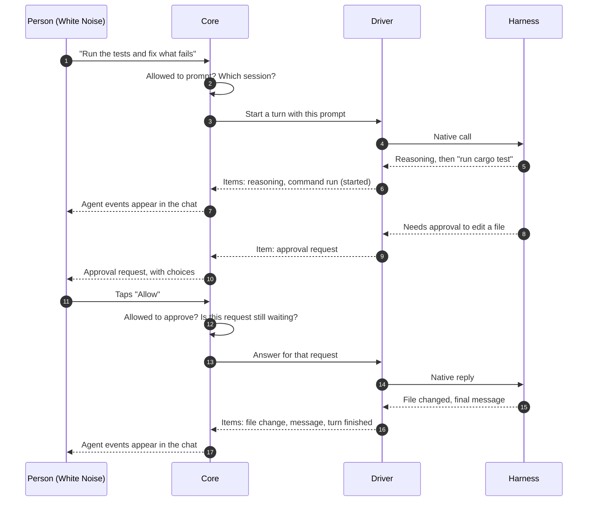

# Architecture

Status: draft. The layers, the core program, the socket and the driver choices are decided
([D-002](../decisions.md#d-002-one-rust-core-program-with-mdk-as-a-library) to
[D-005](../decisions.md#d-005-which-driver-each-harness-gets)). The details on this page are proposals.

Read [the three-minute overview](../README.md) first. This page goes one level deeper: what each part is
responsible for, and what happens during a turn.

## The parts

<picture>
  <source media="(prefers-color-scheme: dark)" srcset="../images/overview-dark.svg">
  
</picture>

### The core program

One Rust program runs on the machine where the agents run. It has two jobs.

**The Marmot side.** It is the agent's member of the group. It uses MDK as a library to hold the account, keep
the encryption state, talk to relays and store messages. Nothing else in this project touches keys or
ciphertext.

**Conversation handling.** It decides what each incoming message means and what to do with it:

- **Permission.** Is this person allowed to prompt the agent, or to approve what it asked? If not, it tells them.
- **Sessions.** Which harness session does this chat belong to? Does one need to be started or resumed?
- **Turns.** Is the agent already working? The message is passed to the driver at once, and the harness does
  with it what it does natively: fold it into the turn, end the turn and start another, or hold it. The core
  keeps no queue of its own
  ([D-040](../decisions.md#d-040-a-message-sent-during-a-turn-goes-straight-to-the-harness)).
- **Routing.** When someone answers an approval or a question, it finds the request that is waiting and hands
  the answer to the right driver.

### Drivers

A driver connects one harness. It has two halves, which are the first two layers.

<picture>
  <source media="(prefers-color-scheme: dark)" srcset="../images/layers-dark.svg">
  
</picture>

**Speaking to the harness.** The driver starts the harness, keeps a two-way session open with it, and keeps
track of what is in progress: the running turn and any requests the harness is waiting on.

**Translating.** The driver turns each native event into a Marmot agent event, and turns each answer or control
from the chat into the harness's own call. Translation has no state of its own, so it can be tested by replaying
a recorded session through it.

A driver knows nothing about Marmot, groups or permissions. The core knows nothing about any harness's
interface.

### The socket

Drivers written in Rust are compiled into the core. Everything else connects over a local socket:

- the Claude Code and Cursor drivers, which are TypeScript programs built on the vendors' official SDKs;
- the Hermes and OpenClaw plugins, which run inside those runtimes;
- later, connectors written by other people.

To the core, a program on the socket is just another driver. It sends the same events and receives the same
controls as a built-in one. See [`socket-protocol.md`](socket-protocol.md).

## What happens during a turn

This example has one approval in it. The person is allowed to prompt and to approve.

Three things to notice:

1. **Every check about people happens in the core** (steps 2 and 12). Drivers never decide who is allowed.
2. **An answer goes to the request that is waiting, not to the model** (steps 11 to 14). It is never treated as
   a new prompt.
3. **The chat sees each step as it happens** (steps 7, 10 and 17), without word-by-word streaming.

## What each layer must never do

| Layer | Must never |
| --- | --- |
| Driver | Decide who may prompt or approve; touch keys, groups or relays |
| Translation | Keep state between events; drop the native payload |
| Conversation handling | Depend on which harness is behind a driver |
| Marmot side | Know anything about agents beyond the shared event kinds |

## Capabilities

Harnesses do not all support the same things. One folds a message sent during a turn into that turn; another
ends the turn. One takes images; another takes nothing.

The proposal is that each driver declares what its harness does as a set of flags. The core reads three of
them: who picks the session, whether a session survives a restart, and which typed commands need the right to
approve. Apps read the rest, to show only the controls that work and to say what a message sent during a turn
will do. Nothing above a driver checks the harness's name. See
[Q-16](../open-questions.md#q-16-how-does-a-driver-say-what-it-supports).

## Where the edges are

| Edge | Between | Form |
| --- | --- | --- |
| Marmot events | Core and the group | Unsigned Nostr-shaped events inside MLS messages; see [`event-model.md`](event-model.md) |
| Driver trait | Core and Rust drivers | A Rust trait; see [`drivers.md`](drivers.md) |
| Socket protocol | Core and other programs | A local socket; see [`socket-protocol.md`](socket-protocol.md) |
| Harness interface | Driver and harness | Whatever the harness provides; see [`../reference/harness-interfaces.md`](../reference/harness-interfaces.md) |
