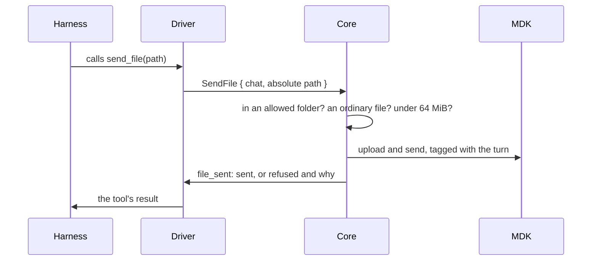

# Drivers

Status: draft. Which driver each harness gets is decided
([D-005](../decisions.md#d-005-which-driver-each-harness-gets)), and so is the preference for official
libraries ([D-006](../decisions.md#d-006-prefer-official-interfaces-and-libraries)), and so are the trait and
the capability flags ([D-058](../decisions.md#d-058-the-driver-trait-and-the-capability-flags)), and so is how
the Codex driver splits its work ([D-060](../decisions.md#d-060-a-codex-translator-follows-one-thread-and-the-transport-routes)),
and how it shows Codex's subagents ([D-117](../decisions.md#d-117-codexs-subagents-are-switched-on-and-shown-flat-in-the-chat-that-started-them),
in threads since [D-142](../decisions.md#d-142-how-subagent-threads-are-built)).
So is how drivers are tested
([D-074](../decisions.md#d-074-every-driver-is-tested-by-replay-and-by-one-end-to-end-scenario)), and what the
Pi driver builds on ([D-086](../decisions.md#d-086-the-pi-driver-reads-pis-rpc-messages-with-types-of-its-own)).
That an agent's file goes to the chat as an attachment from an allowed folder is decided
([D-090](../decisions.md#d-090-an-agent-sends-a-file-as-an-encrypted-attachment-from-an-allowed-folder)); how a
driver asks for it, in [sending a file](#sending-a-file), is decided too
([D-108](../decisions.md#d-108-how-an-agents-file-reaches-the-core-as-built)). That the installers run the harness the person already has, and add our plugin to their own
Hermes and OpenClaw, is decided
([D-102](../decisions.md#d-102-the-installers-connect-to-the-harness-the-person-already-has)); which of their
gateway's settings the installers change is decided too
([D-105](../decisions.md#d-105-which-gateway-settings-the-installers-change)).
That a chat can move a coding harness to another folder is decided
([D-101](../decisions.md#d-101-a-chat-can-move-a-coding-harness-to-another-folder)); how, in
[a chat's folder](#a-chats-folder), is built; the `folders` list, the account home and what a move does are
decided ([D-104](../decisions.md#d-104-how-a-chats-folder-works-as-built)), and the setting's name and refusals
are provisional. That Hermes and OpenClaw are channel plugins, with a narrower contract than a driver, is decided
([D-113](../decisions.md#d-113-hermes-and-openclaw-are-channel-plugins-with-a-narrower-contract-than-a-driver)),
and so is the contract itself, in [channel plugins](#channel-plugins), as written
([D-118](../decisions.md#d-118-the-channel-plugin-contract-is-accepted-as-written)), except the socket's chat
section, which is not designed.

## What a driver does

A driver connects one harness to the core. It does two things:

1. **It speaks the harness's own interface.** It starts the harness, holds a two-way session open, and tracks
   the running turn and any requests the harness is waiting on.
2. **It translates.** Native events become [agent events](event-model.md). Answers and controls from the chat
   become native calls.

It does not decide who is allowed to do anything, and it does not touch Marmot. See
[`architecture.md`](architecture.md).

## The drivers

| Harness | Driver | Language | Interface it speaks | Builds on |
| --- | --- | --- | --- | --- |
| Codex | Native | Rust | `codex app-server`, JSON-RPC over stdio | Types of its own, with Codex's schema as the reference ([D-055](../decisions.md#d-055-the-codex-driver-reads-codexs-messages-with-types-of-its-own)) |
| Pi | Native | Rust | `pi --mode rpc`, JSON lines over stdio | Pi's records read as JSON in its own code, not `pi-codes` ([D-086](../decisions.md#d-086-the-pi-driver-reads-pis-rpc-messages-with-types-of-its-own)) |
| Goose | ACP, with a small Goose flavour | Rust | `goose acp` | `agent-client-protocol` |
| OpenCode | ACP | Rust | `opencode acp` | `agent-client-protocol` |
| Other ACP agents | ACP | Rust | Each agent's ACP command | `agent-client-protocol` |
| Claude Code | Native | TypeScript | The Claude Agent SDK | `@anthropic-ai/claude-agent-sdk` |
| Cursor | ACP | Rust | `cursor-agent acp` | `agent-client-protocol` ([D-080](../decisions.md#d-080-cursor-is-driven-through-acp)) |
| Hermes | Channel plugin | Python | Hermes's platform plugin interface | Hermes itself |
| OpenClaw | Channel plugin | TypeScript | OpenClaw's channel plugin interface | OpenClaw itself |

The facts behind each choice are in [`../reference/harness-interfaces.md`](../reference/harness-interfaces.md).

### Why some are native and some use ACP

The Agent Client Protocol (ACP) is an open standard that many harnesses speak. One ACP driver covers all of
them, so a new harness can be a line of configuration.

ACP's standard part covers what harnesses have in common. What makes a harness distinctive mostly travels in
harness-specific extensions, or is missing. So:

- **A harness gets a native driver** when it matters enough that losing features is not acceptable, or when its
  ACP support is poor. That is Codex, Claude Code and Pi.
- **Everything else uses the ACP driver.** Where a harness needs something the standard lacks, the ACP driver
  gets a small "flavour" for it, as Goose does for steering.

Because all drivers sit behind the same trait, a harness can move from ACP to a native driver later without any
change above the driver.

### Why Hermes and OpenClaw are channel plugins

Hermes and OpenClaw are not coding tools driven by one person. They are messaging gateways with their own idea
of users, channels and routing, and the Marmot plugin is one channel among many inside them. ACP models one
editor user per session, so it has no place for who sent a message or which group it came from. Their own
plugin interfaces do. Each plugin runs inside its gateway and connects to the core over
[the socket](socket-protocol.md). It keeps a narrower contract than a driver
([channel plugins](#channel-plugins)).

### What Hermes can and cannot report

Recordings show that Hermes hands a platform formatted text, not tool events: a line such as "Running a
command" arrives through the same call as a reply. Only approvals and questions arrive in a structured form. So
the Hermes connector can report messages, notices, approvals and questions, and cannot report tool calls as
items without a change on the Hermes side. The plugin sends a line about a tool, like Hermes's heartbeats, as a
message in the commentary phase, which is how Hermes shows it on every platform (provisional). See
[`../reference/hermes-messages.md`](../reference/hermes-messages.md).

## The driver trait

Every Rust driver implements one trait. A first version exists as code, in
[`crates/marmot-agent-driver`](../../crates/marmot-agent-driver). It has the operations of
[the socket's driver section](socket-protocol.md#the-driver-section) and no others, because a program on the
socket does the same job as messages:

- say what the harness is, and what it can do (capabilities);
- take a prompt;
- take an answer to a waiting request;
- take a control: interrupt, new session, change a setting, or one of the harness's own actions;
- hand back the next agent event, or a file the agent asks to send, and hear how that file went
  ([sending a file](#sending-a-file)).

Three things a driver does are not operations of their own. A prompt goes to its chat's session, and names
one only to resume it, so opening and resuming one happen when a prompt arrives
([D-065](../decisions.md#d-065-a-prompt-names-a-session-only-to-resume-one)). A message sent during a turn is a prompt like any other, so there
is no "steer". And "new session" is a control.

It is decided ([D-058](../decisions.md#d-058-the-driver-trait-and-the-capability-flags)). The core waits for
every request to return
([D-066](../decisions.md#d-066-the-core-finishes-every-request-it-starts)).

## Sending a file

Decided ([D-108](../decisions.md#d-108-how-an-agents-file-reaches-the-core-as-built)). What it builds on is the
outcome
([D-090](../decisions.md#d-090-an-agent-sends-a-file-as-an-encrypted-attachment-from-an-allowed-folder)): the
file goes to the chat as an ordinary encrypted attachment, tagged with its turn, and only from folders the
settings allow.



- **The harness asks with a tool the driver gives it.** Codex gets a dynamic tool, `send_file`, on every
  session the driver starts, and Codex keeps it when a session is resumed. Claude Code gets an in-process MCP
  server from the Agent SDK with the same tool, which Claude Code calls `mcp__marmot__send_file`. Pi gets it
  from a small extension of the driver's own, loaded into each chat's Pi ([the Pi driver](#the-pi-driver)). An
  ACP agent (OpenCode, Goose, Cursor) gets an MCP server the ACP driver serves itself, over HTTP on the loopback
  address, on every session it opens or takes up, unless its settings say `send_files = false`
  ([D-110](../decisions.md#d-110-an-acp-agent-gets-the-file-tool-from-a-loopback-mcp-server-on-by-default), [the ACP driver](#the-acp-driver)). All take one
  argument, `path`. The model is never asked to write a path into its answer, and nothing in its words is read
  as a request to send by the driver. A gateway's plugin takes the gateway's own way instead
  ([below](#a-gateways-files)).
- **The driver hands the core a request.** `next_event` gives either an event or `SendFile`: the driver's own
  id for the request, the chat, and the path. The driver makes a relative path whole by putting the chat's
  session folder in front, leaving any `..` for the core to follow; the core takes only an absolute one. The core answers through `file_sent`, with the result and, for a
  refusal, a reason and a sentence that names no path. The driver passes that back to the harness as the
  tool's result. On the socket this is the `send_file` request
  ([the messages, as built](socket-protocol.md#the-messages-as-built)).
- **The core decides.** It reads only from the folders `files_from` lists. By default that is the chat's
  folder ([a chat's folder](#a-chats-folder)): the one the chat chose, or else the harness's working folder,
  which a harness the core runs (Codex, Pi, an ACP agent) has in the settings and a connector on the socket
  states in its hello. A connector that states none has no folder until the settings list one, as the installers do
  for Hermes and OpenClaw ([a gateway's files](#a-gateways-files)). A folder a chat
  chose that holds the account home, as `~` does, is used for files like any other, under the rule below that
  keeps the home's files out. The core opens each folder when it starts, or when the file is sent for a chat's own, and
  follows a path from that open folder one part at a time, never letting the system follow a link: a link on
  the way is read and followed by its words by the same rule, so it may lead elsewhere inside but never out,
  and a `..` never climbs above the folder. A folder on the way swapped for a link meanwhile cannot lead out
  either. It also refuses a file with a second name (a hard link, which could be outside), anything but an
  ordinary file, an empty file, and one over 64 MiB, well under the 512 MiB MDK uploads in one piece.
- **Never the agent's own home.** Whatever the folders, the core refuses a file inside the account home, which
  holds the agent's keys ([D-099](../decisions.md#d-099-files-from-the-agents-own-home-are-refused-by-default-and-the-owner-may-allow-them)):
  one whose way from the allowed folder passes through the home, known by its device and inode however it is
  named or linked, or one in an allowed folder that lies inside the home. So a working folder of `~` lets the
  agent send its work but not its keys. A folder in `files_from` that is, holds or lies inside the home stops
  the core from starting. The owner may allow both with one line in the settings,
  `send_files_from_agent_home = true`. Whether an allowed folder lies inside the home is found from the
  folder held open, by going up from it; when the way up cannot be followed, the folder counts as inside.
  Known limit: a bind mount can show part of the home elsewhere, where the way up does not pass through the
  home, so a file reached through one is not refused. Telling that would mean reading the mount table.
- **Sending runs on the side.** Uploading can take long, so it runs as a task of its own while the chats go
  on, and the core tells the driver once it is done. The core offers the file to MDK again only while MDK says
  it is busy, which it says only before it has taken the file, for about half a minute. Any other failure is
  reported as `failed` and not tried again, since MDK may have sent the file anyway, and a post cannot be
  taken back. Known limit: a file is sent without a token, because MDK's token form of an upload carries no
  tags, so the file would lose its turn ([MDK issue 3610](https://github.com/marmot-protocol/mdk/issues/3610)).
  The core keeps nothing of a file on disk while it sends it. A core that stops or crashes during an upload
  sends nothing again when it starts, so a file goes out at most once, but nobody learns whether it went: the
  harness's call gets no answer, and its turn is closed as interrupted
  ([D-070](../decisions.md#d-070-a-restart-closes-the-turn-as-interrupted)). If the harness, or a person, asks
  for the file again, it may go out twice. Once MDK's token form takes tags, the core can keep a file's send on
  disk under a token, as it does every other send, and finish it after a restart.
- **What people see.** The file arrives as a chat message carrying the attachment and the turn's tag, as the
  agent's words do ([D-022](../decisions.md#d-022-the-agents-words-are-ordinary-chat-messages)), and alerts
  like an answer. The tool call shows as a `tool` item. A refused file shows as the core's refused notice
  ([D-077](../decisions.md#d-077-a-refused-notice-says-why-something-was-not-acted-on)), with the reason
  `not_allowed`, `invalid`, `not_supported`, `busy` or `failed`, and never the path
  ([D-071](../decisions.md#d-071-what-may-be-logged)).
- **Who may.** Calling the tool needs nobody's approval in the chat: the Claude Code connector allows it in
  its permission callback, Codex does not ask for a dynamic tool, and Pi asks nobody before any tool. The
  folders are the limit, as the owner set them. An ACP agent that asks its client before an MCP tool (Cursor
  always; Goose in `approve` mode) asks in the chat, like any approval: the ACP driver answers no approval
  itself ([D-110](../decisions.md#d-110-an-acp-agent-gets-the-file-tool-from-a-loopback-mcp-server-on-by-default)).

### A gateway's files

Decided ([D-108](../decisions.md#d-108-how-an-agents-file-reaches-the-core-as-built)). Hermes and OpenClaw already let their agent send a
file to any chat platform: the agent writes a `MEDIA:<path>` line in its answer, or a tool attaches a file, and
the gateway hands the platform the file. Each plugin turns that into the core's `send_file`, one request for
each file, as today's connectors turn it into `send_media`.

- **Hermes** calls the platform's `send_document`, `send_image_file`, `send_video`, `send_voice` or
  `send_multiple_images`, after its own checks, which make the path whole. The plugin asks the core for each
  file, with the path as Hermes gave it, and answers Hermes with a `SendResult`: sent when one went. When the
  core refused, the result tells Hermes not to post its own notice, which would name the file: the chat has
  the core's.
- **OpenClaw** hands a reply's files to the channel with the reply, as `mediaUrl` and `mediaUrls`. The plugin
  asks the core for each local one once the reply's text is on its way, and does the same for media OpenClaw
  sends to a chat through the channel's outbound adapter, whose caption goes first as the agent's words. That
  send fails when the core refuses the file or cannot be asked, and has a receipt only once the core sent
  it. The channel now says it takes media. OpenClaw hands a reply's file over as a copy in its outbound media
  store, which the core never allows; the plugin sends the path the agent named, which OpenClaw keeps beside
  the payload in a record its plugin SDK does not export, and a copy with no path recorded goes as it is
  named, so the core refuses it. A relative path
  is taken from the agent's workspace, as OpenClaw takes it; an address on the web, or a stored inbound
  attachment, is not sent.
- **A caption goes as the agent's words**, before the files, since `send_file` carries none. A batch keeps one
  caption, its first, as today's Hermes connector does. In OpenClaw the caption is the reply's own text, or the
  outbound send's.
- **The folder is the gateway's.** A plugin states no folder in its hello, so the installer lists the folder
  the gateway's agent works in as `files_from`, and makes it if it is not there, since the core opens it when
  it starts: Hermes's `terminal.cwd`, or the workspace of the OpenClaw agent that takes the Marmot chats, as
  `openclaw agents list` and `openclaw agents bindings` say (`~/.openclaw/workspace` by default). It lists
  none when that folder is the whole home, as Hermes's default is, or holds or lies in the agents' data or
  the agent's own home (an imported agent's stays where the old connector had it) or the backup the import
  took of that home, or holds or lies in the gateway's media cache (Hermes's home; OpenClaw's media store),
  or holds OpenClaw's state folder, or when Hermes runs its commands in a sandbox, or OpenClaw's Marmot chats
  may go to more than one agent; the settings and the summary then say how to name one. The media caches are
  never listed: they also hold the files people sent the gateway in any of its chats, on any platform.
  Settings kept from an earlier install that list no folder get the one found now; a `files_from` already
  there is left as it is, except that `--replace-plugin`, for an install moved over ([move](../move.md)), lists the gateway's folder,
  found the same way, after the old connector's media folders in the `files_from` line the import wrote. It
  changes only that line, known by the import's comment directly above it, and only while the line is still
  one the import writes, a list of strings in one line; the import's comment then gives way to one that
  names the folder added, so a run again changes nothing, or lists the gateway's new folder in place of that
  one if it has moved. Any other `files_from` line is the person's, and left as it is: the summary says to
  add the folder
  ([D-119](../decisions.md#d-119-how-a-gateway-install-moves-over-its-work-folder-a-half-done-openclaw-move-a-fresh-conversation)).
  The containers this project runs Hermes and OpenClaw in mount the work folder at its own path, so a path
  the agent names is the same for the core.

## A chat's folder

Each chat of a coding harness (Codex, Claude Code, OpenCode, Goose, Cursor and Pi) works in a folder of its
own choosing ([D-101](../decisions.md#d-101-a-chat-can-move-a-coding-harness-to-another-folder)). Hermes and
OpenClaw keep the workspace they manage. Built 2026-11-22; what other programs and people see is provisional.

- **The core owns the rule.** A driver states its own folder, the install folder, through `Driver::folder`
  (a connector, as `folder` in its hello). Only then does the core offer the setting. It keeps each chat's
  folder in its state file, so it survives a restart, and checks it again when it starts: a folder the
  settings no longer allow is dropped, with the chat's session there, and the chat goes back to the install
  folder.
- **The chat sees it as a setting.** The core adds a setting `folder` ("Folder") to every session item of such
  a harness, after the harness's own: its value is the folder the session started in, its accepted values are
  not listed, and it is marked as needing the right to approve
  ([D-043](../decisions.md#d-043-a-setting-says-which-right-it-needs)). A session keeps the folder it started
  in.
- **Someone who may approve sets it**, with a `set` control naming `folder` and a path. A path may start with
  `~`, the home; a relative one is taken from the chat's current folder. The core resolves it one name at a
  time, links followed and `..` taken away, and takes it only if it is a folder inside one of those the
  settings list in `folders` (by default the install folder; listing `~` allows any folder in the home). The
  agent's account home, and any folder inside it, is never allowed ([D-104](../decisions.md#d-104-how-a-chats-folder-works-as-built)). Nothing outside those
  folders is read on disk: a path that leads outside, as written or through a link, is refused with the core's
  refused notice, reason `not_allowed`, whether what it leads to is there or not; one inside that is not
  there, or is not a folder, with `invalid`. Neither names the path, and nothing about it is logged
  ([D-071](../decisions.md#d-071-what-may-be-logged)).
- **It applies from the next session, so setting it starts one.** The core hands the driver a new session for
  the chat, with the new folder on the chat (`Chat::folder`). The folder is the chat's once the new
  session's item shows, which settles the `set`: the folder and the session are saved together, and a new
  session the driver or the harness refuses moves nothing. Every new session works this way, a plain one in
  the folder the chat had when it was asked for, and the chat takes each folder in the order the driver
  shows their sessions. A new session that shows only after the core settled it for want of
  an effect ([D-087](../decisions.md#d-087-the-core-settles-a-request-whose-effect-never-shows)) still
  counts, so a late move still moves the chat, since the harness works there then: the person was told
  `no_effect` at two minutes, and the session item shows the new folder later
  ([D-128](../decisions.md#d-128-a-folder-move-whose-session-shows-late-still-moves-the-chat)). The core keeps such late
  ones only while the driver runs, since only a running driver can still show one. A session the driver starts for a prompt meanwhile
  starts in the new folder. Every prompt after names the folder, and the driver starts the chat's next session
  there, or takes up its session there after a restart. A chat that chose none is named no folder, and works in the driver's own.
- **Each driver:** Codex gives the folder as `cwd` on `thread/start` and `thread/resume`; an ACP agent as
  `cwd` on `session/new`, `session/load` and `session/resume`; Claude Code as the query's `cwd`. Pi works where
  it was started, so its driver starts each chat's Pi in the chat's folder, and a new session in another folder
  stops the chat's Pi and starts a new one there. `tools/pi/pi.sh` mounts the folder it is started in, and
  refuses one that holds the agent's state or key. Goose's test container (`tools/goose/goose-acp.sh`) mounts
  only its own work folder, so a chat that moves elsewhere fails there; a natively installed Goose
  ([D-102](../decisions.md#d-102-the-installers-connect-to-the-harness-the-person-already-has)) does not.

## Capabilities

Each driver declares what its harness can do: interrupt a turn, what it does with a message sent during one,
resume a session, take attachments, and so on. The core and the clients read these flags and never check a
harness's name. A driver states every flag; none is optional.

The flags, with what Codex states for each, are in
[D-058](../decisions.md#d-058-the-driver-trait-and-the-capability-flags).

## Testing with recorded sessions

Record a real session with a harness: every message in both directions. Replay it through the driver in a test
and check the agent events that come out. When a harness changes its interface, a new recording shows the
difference.

Hand-written test messages are a guess about what the harness sends. Recordings are what it sends.

The Codex driver is tested this way: each of its recordings must give the events the prototype gives
([`crates/marmot-agent-codex/tests/replay.rs`](../../crates/marmot-agent-codex/tests/replay.rs)). Every driver
is tested so, and by one end-to-end scenario
([D-074](../decisions.md#d-074-every-driver-is-tested-by-replay-and-by-one-end-to-end-scenario)). Every
driver also passes the [conformance suite](../../crates/marmot-agent-conformance/README.md), on a fake harness
that can fail in each way review found drivers mishandle.

## The Codex driver

It has two halves: a translator, which turns the messages of one chat's Codex session into agent events and
builds what the driver sends, and a transport, which runs `codex app-server` and gives each translator its own
thread's messages ([D-060](../decisions.md#d-060-a-codex-translator-follows-one-thread-and-the-transport-routes)).
A session starts in a working folder with a narrow sandbox unless configured otherwise
([D-061](../decisions.md#d-061-a-codex-session-starts-in-a-working-folder-with-a-safe-sandbox-unless-configured)),
Codex reads a group message with its sender's name
([D-062](../decisions.md#d-062-what-codex-reads-for-a-chat-message)), Codex keeps each session so it can be
resumed ([D-063](../decisions.md#d-063-codex-keeps-a-session-so-it-can-be-resumed)), and a form from an MCP
server is declined for now ([D-064](../decisions.md#d-064-the-codex-driver-declines-an-mcp-servers-form-until-forms-are-designed)). Both halves are written
([`crates/marmot-agent-codex`](../../crates/marmot-agent-codex)). The transport runs one Codex for every chat of an
agent, with Codex's subagents on, shown in the chat of the turn that started them, each in a thread of its own
([D-117](../decisions.md#d-117-codexs-subagents-are-switched-on-and-shown-flat-in-the-chat-that-started-them),
[subagents as threads](subagents.md), [D-142](../decisions.md#d-142-how-subagent-threads-are-built)). Each
subagent's thread gets a translator of its own in its parent's chat. The subagent is one `task` item, `task:` and
its thread's id, which each of its turns opens again and which shows its newest turn's state (an earlier turn's
end read late changes it only to say, in its text, that the turn failed); everything else it does names that item in the event's
`subagent` field, and a nested subagent's `task` item names the one that started it. Its words name the
`subagent` tool item that started it as `parent`. The driver says its harness tells subagents apart
(`subagents`), so the core puts all of it in the subagent's thread; a message for a thread not yet named is held until the item that names it arrives. Codex waits for a
reply to each of its requests, so one no chat takes is refused with an error, which Codex takes as a refusal: one
the driver cannot show, one for a thread a chat left, and one for a thread never seen once no session is being
picked and no subagent being started (an open `spawnAgent` item), since until then it may be a subagent's not
yet named. Codex does not stop
a subagent when its parent is interrupted, so Stop interrupts every running turn under the one it names, each
parent before the subagents it started, and one whose start arrives while it waits, and is settled by the end of
the last, or as failed by Codex's refusal to stop one that runs on. A Stop in a subagent's thread names that
subagent, and the driver says it can stop one (`stop_subagent`): it interrupts that subagent's turn and those of
the subagents it started, and nothing else
([D-149](../decisions.md#d-149-stop-in-a-subagents-thread-stops-that-subagent-alone)). A turn is interrupted once however many
Stops wait for it: a later Stop joins the interrupt already sent. Item ids the driver makes up name a
subagent's thread, since every translator of a chat counts from 0. When the chat's session is replaced, its
subagents are interrupted; their open items close then, and when Codex stops. One that a Stop is waiting for
is followed until Codex says whether it stopped, which settles the Stop, and its items close then
([D-132](../decisions.md#d-132-a-stop-waiting-for-a-subagent-is-settled-by-codex-after-a-new-session)). Every session it starts gets the driver's `send_file` tool
([sending a file](#sending-a-file)); a call becomes a `tool` item, of kind `other`, like any tool. A
request waits for Codex at most a minute in all, to read what the driver writes, to pick a session, or for a
request before it; a Codex that has not read or answered by then has stopped working, and the connection ends,
so nothing it says later is read and a message cut short is never finished
([D-066](../decisions.md#d-066-the-core-finishes-every-request-it-starts); found by the conformance suite's
`never_answers` and `stops_reading`, 2026-11-22).

## The Claude Code driver

A separate TypeScript program, [`packages/claude-code`](../../packages/claude-code), that runs Claude Code
through the official Claude Agent SDK (pinned exactly, at 0.3.331, which runs Claude Code 2.1.331) and connects
to the core over the [socket](socket-protocol.md#the-messages-as-built). The core is started with a
`[connector]` section in place of `[codex]`; then:

```sh
cd packages/claude-code
npm ci
node src/main.ts --home <agent home> --cwd <project folder> [--model <model>] [--permission-mode default]
```

It finds the socket and its token in the agent's home, and exits when the core closes the socket. It loads no
Claude Code settings files (the SDK's `settingSources` is empty,
[D-082](../decisions.md#d-082-the-claude-code-driver-loads-no-claude-code-settings-files)), so no allow rule or hook in the owner's own
Claude Code settings approves or runs anything in a chat; a side effect is that it reads no `CLAUDE.md` either.
It has the
same two halves as the Codex driver. The translator (`src/translate.ts`) turns one chat's Claude Code messages
into agent events and is tested against the recordings. The transport (`src/connector.ts`) runs one SDK
session per chat:

- A prompt starts the chat's session if none is running, resuming the one the core names
  ([D-065](../decisions.md#d-065-a-prompt-names-a-session-only-to-resume-one)), and goes in as a user message,
  written as for Codex ([D-062](../decisions.md#d-062-what-codex-reads-for-a-chat-message)). The next turn
  names the prompts sent since the last one. Only a fresh session takes `--model` and `--permission-mode`; a
  resumed one keeps the model and permission mode it last showed. If Claude Code stops in the middle of a
  turn, the turn ends cancelled and the next prompt resumes the session.
- An approval waits in Claude Code's `canUseTool` callback until the answer comes. "Allow once" allows the
  call as asked, a standing choice allows it with the rule Claude Code suggested, and the last choice denies.
  A question from `AskUserQuestion` is answered the same way. Each waits under the id the SDK gives the
  request; one that came without, or with an empty one, would get one of the connector's own, so two never
  share an item.
- Interrupt calls `interrupt()`, and is taken once Claude Code has it: Claude Code may reply only once the
  turn has stopped, later than the core waits. A reply within two seconds that refuses it refuses the request.
  New session closes the chat's SDK session, and the next prompt starts a fresh one. `set` changes the
  permission mode or the model.
- The event that shows an answer's or a control's effect names it
  ([D-028](../decisions.md#d-028-an-answer-or-a-control-is-a-request-and-the-agents-reply-settles-it)): the
  approval's next edit, the end of the turn as interrupted (a turn that finished on its own first settles
  nothing, and the core settles the interrupt as having no effect), the session item's edit that shows the new setting
  (sent as soon as Claude Code takes it), or the end of the old session.
- An event too large for a line of the socket (4 MB) goes without its native message, and if it is still too
  large, with its longest texts cut in the middle until it fits. Its `prompts` and `settles` are kept.
- Every query gets the connector's `send_file` tool (`src/files.ts`), an in-process MCP server, which
  `canUseTool` allows without asking the chat. A call sends the core a `send_file` request and tells Claude Code what the core answered
  ([sending a file](#sending-a-file)). The connector states the folder given as `--cwd` in its hello, so the
  core sends files from the chat's folder without `files_from` ([a chat's folder](#a-chats-folder)).
- A query starts in the chat's folder when the prompt names one, and in `--cwd` otherwise; a running query
  stays where it is. A new session ends the query, and the next prompt, which names the folder, starts the new
  one there. Claude Code keeps a session with its folder, so a resumed session is taken up in the same folder.

Its capabilities: it can interrupt; a message sent during a turn ends the turn and starts another (`restart`,
[D-040](../decisions.md#d-040-a-message-sent-during-a-turn-goes-straight-to-the-harness)); the core names the
sessions, and they can be resumed; approvals come to the chat; no approval commands. It takes no files yet
(`files_in` is `none`, [D-083](../decisions.md#d-083-the-core-passes-no-files-to-a-harness-yet)): Claude Code reads images, and
passing them on is a later step.

## The ACP driver

Built into the core, in [`crates/marmot-agent-acp`](../../crates/marmot-agent-acp), with the same two halves as
the Codex driver. It reads ACP with the official types (`agent-client-protocol-schema`). The translator turns one
chat's ACP session into agent events and is tested against the OpenCode, Goose and Cursor recordings; the
transport runs one agent process for every chat of an agent, routes each message to the chat whose session it
names, and is tested against a stand-in agent. What each agent sends is in
[`reference/harness-messages.md`](../reference/harness-messages.md#acp-opencode).

The core is started with an `[acp]` section in place of `[codex]`:

```toml
[acp]
name = "opencode"                 # what events call the agent until it names itself; Cursor never does
command = ["opencode", "acp"]     # or ["cursor-agent", "acp"], ["goose", "acp"], or Goose's container, below
cwd = "/home/me/work"
# send_files = false              # the send_file tool is on unless this says false (D-110)
```

- **Goose, OpenCode and Cursor run on the host**, as the person's own programs, with their own settings and
  sign-in: the installers expect them on `PATH` and install none
  ([D-102](../decisions.md#d-102-the-installers-connect-to-the-harness-the-person-already-has)). Goose runs as
  `goose acp`, on the model its own settings name (`goose configure`), and reads `GOOSE_MODE` from its
  environment.
- **Goose can also run in a throwaway container**, as this project's tests and recordings run it, and as
  `install/goose.sh --container` sets it up. `tools/goose/goose-acp.sh <model-key-file> [goose-home]` builds
  the image from [`tools/goose`](../../tools/goose/Dockerfile) (Goose pinned, with its checksum) and runs it
  with `docker run -i --rm`, speaking ACP on its standard input and output. The work folder is mounted at the
  same path, so the paths the core and Goose name agree; Goose's sessions live in `goose-home`, so they survive
  the container; the model key file is mounted read-only and never copied. The script refuses a work folder
  that holds `goose-home` or the key, or lies inside `goose-home`, or holds or lies inside the folder of every agent, which the installer names in `MARMOT_AGENT_DATA`,
  links resolved, and Docker keeps no log of
  the container, since what Goose writes holds the conversation. So the command is
  `["<repo>/tools/goose/goose-acp.sh", "<model-key-file>", "<goose-home>"]`, with the endpoint and the model
  in `MODEL_BASE_URL` and `MODEL_NAME` in its environment; neither has a default ([D-100](../decisions.md#d-100-the-installers-defaults)).
  Goose runs in its own default mode, `auto`, which asks nothing; `GOOSE_MODE=approve` makes it ask in the chat
  before every tool call.
- **A prompt** starts the chat's session if it has none (`session/new`), or takes up the one the core names
  ([D-065](../decisions.md#d-065-a-prompt-names-a-session-only-to-resume-one)) with `session/resume` when the
  agent offers it and `session/load` otherwise; what `session/load` replays is not sent again. Goose, after taking up a
  session, carries on by itself with the turn a crash cut off, says so in `_meta.goose.activeRunId`, and
  refuses a prompt until it clears it; before every prompt, the driver cancels such a run, answers what it
  asks meanwhile as cancelled, and holds the prompt until Goose clears it, since a restart closes the turn
  ([D-070](../decisions.md#d-070-a-restart-closes-the-turn-as-interrupted)). Other agents are not waited for. The prompt
  is written as for Codex ([D-062](../decisions.md#d-062-what-codex-reads-for-a-chat-message)), as text only.
  A turn is named after the session and the prompt's request id; request ids start from the time, so a turn
  never takes the name of one from before a restart.
- **An approval** is answered with the option of the choice made; **a question** (an elicitation form) with
  the values of the options chosen, and typed text in the question's free-text field.
- **Interrupt** answers the requests still waiting as cancelled, as ACP asks, then sends `session/cancel`;
  until the turn ends, a request the agent makes is answered as cancelled at once. A message sent during a
  turn does the same, waits up to a minute for the turn to end, then prompts (`restart`). **New
  session** sends `session/new`, only when no turn is running. **`set`** sends `session/set_config_option`, and is settled by its reply, even one that changed nothing.
- **Item ids** of tools, approvals and questions name the session as well as the agent's tool-call id, which
  is the agent's own for one session; so an answer can only reach the chat whose request it names.
- **Writing**: each message goes whole to a task that writes it, so a call the core abandons never leaves
  half a message on the agent's input. A request returns only once its message is written, and only then
  is it fed to the chat's translator: an answer the agent can no longer read is refused as failed, not
  shown as given (found by the conformance suite's `answer_after_death`, 2026-11-22).
- **Waiting has a limit.** A session request, the end of a cancelled turn and the end of Goose's own run are
  each waited for up to a minute, and so is the writing of a request's message. A session request not
  answered, or a message not written, by then ends the connection: the task that writes ends with it, and
  nothing the agent says later is read, so a late reply cannot install a session after the prompt failed and
  a message cut short never reaches the agent (found by the conformance suite's `stops_reading`,
  2026-11-22).
- **Cursor's `cursor/update_todos`** names its tool call and no session; it goes to the chat whose session
  has that tool call.
- **Requests nobody is asked about** are answered at once: Cursor's `cursor/update_todos` is taken, anything
  else unknown is refused, so the agent never waits for ever.
- **Sending a file** ([sending a file](#sending-a-file)). Decided
  ([D-110](../decisions.md#d-110-an-acp-agent-gets-the-file-tool-from-a-loopback-mcp-server-on-by-default)). On unless the `[acp]` settings say
  `send_files = false`, which leaves the driver listening on nothing and handing the agent no server. When on,
  an agent that takes MCP servers
  over HTTP (`mcpCapabilities.http`, which OpenCode, Goose and Cursor all state) is given the driver's own on
  `session/new`, `session/load` and `session/resume`, named `marmot`, with one tool, `send_file`. The driver
  serves it with the official MCP library (`rmcp`), on `127.0.0.1` and a port the system picks, stateless,
  answering in plain JSON; it refuses a `Host` that is not the loopback. Each chat has a token of its own for
  each folder it opens a session in, 128 random bits, which the agent sends in an `Authorization` header and
  never in the address, since OpenCode writes the address into its log. A request without a token the driver
  gave is refused before MCP reads it. A tool call goes to the chat whose session the call names in its
  `_meta` (OpenCode: `ai.opencode/sessionID`; Goose: `agent-session-id`), and that session must be the token's
  own chat's (Goose), or, for OpenCode, a session of a chat working in the token's folder: OpenCode keeps one
  server of a name for every session in a folder, the one handed over last, so its calls carry whichever
  chat's token came last there, and the token alone would send one chat's file to another. A call that names
  no session goes to the chat whose token it carries (Cursor, which keeps a server for each session); from
  OpenCode or Goose, which always name it, it is refused. A call naming a session no chat has (such as one of OpenCode's subagents), another
  chat's session, or a session in a shape the driver cannot read, is refused, never guessed. A relative path
  is made whole from the chat's folder, which changes only once the agent has opened a session in the new
  one. While a file waits for the core's word, a prompt to that chat that would restart its turn is refused
  as busy: the turn waits on the tool's result, which the core can give only once the prompt returns. When
  the driver stops, a call in flight is answered as not sent, and a connection still sending its request is
  closed within two seconds. An agent that takes no MCP server over HTTP is
  given none, and has no tool. Goose in its container cannot reach the loopback address, so its
  installer writes `send_files = false` there, and it has no tool; on the host it has. What each agent does was read in its source or seen on the wire
  ([harness interfaces](../reference/harness-interfaces.md#mcp-servers-from-the-client-over-acp)).

Its capabilities: it can interrupt; a message during a turn restarts it; the core names the sessions, which
can be resumed when the agent can load or resume them; approvals come to the chat; no approval commands; no
files passed to the agent ([D-083](../decisions.md#d-083-the-core-passes-no-files-to-a-harness-yet)).

## The Pi driver

Built in, in [`crates/marmot-agent-pi`](../../crates/marmot-agent-pi), with the same two halves as the Codex
driver. The translator turns one Pi's records into agent events and is tested against
[the recordings](../../fixtures/recordings/README.md#pi); the transport runs Pi and implements the trait. The
core is started with a `[pi]` section in place of `[codex]`:

```toml
[pi]
cwd = "/home/me/work"
program = "pi"                       # the default; or "tools/pi/pi.sh", to run Pi in a container
args = []                            # for pi.sh: ["<model key file>", "<Pi's state folder>"]
```

- **One Pi per chat.** Pi in RPC mode holds one session at a time, so each chat gets its own Pi process,
  started as `program args… --mode rpc` in the chat's folder, or `cwd` when it chose none
  ([a chat's folder](#a-chats-folder)), when the chat first needs it. A session is resumed by
  starting Pi with `--session <id>`: when the core names one ([D-065](../decisions.md#d-065-a-prompt-names-a-session-only-to-resume-one)),
  and when the chat's Pi has stopped. Pi writes a session's file only once it holds a message, so a session
  that never did, such as a new one the core was restarted after, has none: then the driver starts Pi with
  `--session-id <id>`, which makes it again, empty, with the same id. A session the driver has seen hold a
  message is not made again if its file has gone; the prompt is refused. Before the first prompt the driver
  asks for the state, the models, the thinking levels and the commands, which the session item shows, and
  once, at start, for `pi --version`. Pi 1.6.0 reads nothing until its extensions' start-up handlers have
  finished, so a question one asks then could never be answered: the driver treats it as a failed start, as
  it does a Pi that has not answered within a minute or comes up in another session, and stops that Pi.
- **As the person's own `pi`, by default.** The installer expects Pi on `PATH`, set up with a model provider,
  and installs none ([D-102](../decisions.md#d-102-the-installers-connect-to-the-harness-the-person-already-has)).
  Each chat's Pi runs as the person, in the work folder, with Pi's own settings and sessions. Pi asks nobody
  before a tool runs, so it acts with the person's own rights, as it does when they run it themselves.
- **Or in a container**, for a boundary, as this project's tests run it and as `install/pi.sh --container`
  sets it up. [`tools/pi/pi.sh`](../../tools/pi/pi.sh) runs Pi in a throwaway Docker container built
  from [`tools/pi/Dockerfile`](../../tools/pi/Dockerfile), Pi pinned at 1.6.0, on standard input and output.
  The working folder is mounted at the same path, and the model key file from the first argument, read-only.
  `MODEL_BASE_URL` and `MODEL_NAME` name the endpoint and the model; neither has a default ([D-100](../decisions.md#d-100-the-installers-defaults)).
  Pi reads the key from that file when it calls the model, so it is in no image, environment variable or file
  Pi writes. Of Pi's state folder, the second argument, each chat's Pi gets only the chat's own folder, so it
  cannot read another chat's sessions: the driver names the chat in `MARMOT_AGENT_CHAT`, as a hash of its id.
  Since the working folder is mounted read-write, the script refuses to start if it holds the state folder or
  the key file, or lies inside the state folder, or holds or lies inside the folder of every agent, which the installer names in `MARMOT_AGENT_DATA`, links resolved.
  Asking Pi its version, whatever arguments come
  before `--version`, gets an empty state folder.
  Docker keeps no log of the container, since what Pi writes holds the conversation. When the driver stops a
  Pi, its standard input closes and the script gets SIGTERM, then SIGKILL after ten seconds; the script removes
  the container, so a command it was running is killed, and nothing after it runs. It waits for one Docker is
  still creating, and removes that too. A chat's container is named
  after the chat's state folder, so one left running when the core itself was killed outright is removed the
  next time that chat's Pi starts.
- **A turn** is a Pi run, from `agent_start` to `agent_settled`, so Pi's own retries and steered messages
  stay in it. Pi gives turns no id; the driver names one after the session and the timestamp of its first
  message.
- **A prompt** goes as Pi's `prompt` command, always with `streamingBehavior: steer`, written as for Codex
  ([D-062](../decisions.md#d-062-what-codex-reads-for-a-chat-message)). During a turn Pi delivers it after the
  running tool calls, before its next model call, in the same turn (`fold`). A slash command naming an
  extension's command runs at once and starts no turn. A request returns once its record is written to Pi,
  without waiting for Pi to respond: Pi responds to a prompt only after an extension's handler has finished,
  and the handler may be waiting for the chat's answer to a question. Pi's response, read in turn with its
  other records, says which turn responds to the prompt: the next one (`started`), the running one (`queued`),
  or none. If Pi refuses it, the error item that makes says so.
- **A Pi that stops reading.** A request waits at most a minute for its record to be written to the chat's Pi
  ([D-098](../decisions.md#d-098-a-harness-that-stops-reading-ends-its-connection)). The task that writes to
  the Pi keeps that deadline itself: a record not written in full by then never reaches Pi whole, as the task
  lets go of Pi's input, and of whatever else waited to be written, before it says so. A Pi that has not read it
  has stopped working ([D-066](../decisions.md#d-066-the-core-finishes-every-request-it-starts)): the driver
  stops that Pi as it stops any (the script removes its container), so nothing queued for it reaches a later
  Pi. The chat's open items close, as for any Pi that stops, and the request is refused as failed. Only that
  chat's Pi stops: the others run on, and the chat's next prompt takes its session up in a new Pi.
- **Interrupt** sends `abort`; the end of the turn settles it. **New session** sends `new_session`, and the new
  session item settles it. **`set`** changes `model` (`provider/id`) or `thinking`; the session item's edit
  settles it, made again if the setting kept its value, since Pi then says nothing. The one action,
  `compact`, is settled by the end of the compaction it asked for, not one Pi starts of its own accord; a
  second one while it runs is refused as busy, since Pi would abort the first. Pi's refusal of any of them, or an extension cancelling a
  new session, is an error item that settles it. If Pi stops before a control has had its effect, an error
  item the driver makes settles it as failed; the items the driver closes for a stopped Pi settle nothing.
- **Sending a file.** Pi's RPC mode lets a client add no tool of its own, and an extension is Pi's own way to
  add one (`pi.registerTool`), so the driver ships a small one,
  [`extension/send-file.ts`](../../crates/marmot-agent-pi/extension/send-file.ts), built into the driver. At
  start the driver writes it into a folder of its own, which only its user can open and which goes with the
  driver, and starts each chat's Pi with `--extension <that file>`, which Pi loads even when the person's
  settings turn their own extensions off. A native Pi reads it where it is. In the container, `pi.sh`
  mounts that one file read-only at the same path, which the driver names in `MARMOT_AGENT_PI_EXTENSION`,
  and refuses one inside the state folder. Nothing is installed, and nothing of the person's Pi changes. The
  extension's `send_file` tool asks the driver through Pi's extension UI, in an `input` dialog titled
  `marmot-agent send_file` that carries the path. The driver takes that dialog as the request
  ([sending a file](#sending-a-file)); it never reaches the chat as a question. It makes a relative path whole
  from the folder the chat's Pi works in, and answers the dialog with what the core said, which the tool gives
  the model as its result, an error if the file was not sent. The tool call shows as a `tool` item, from Pi's
  own records. A dialog that names no path is refused at once, since the tool waits for its answer. If the
  turn is stopped while the core sends, the tool stops waiting; the file may still arrive. Built 2026-11-22;
  the tool's name, words and the dialog are provisional.
- **Approvals.** Pi has none: it asks nobody before a tool runs, so `approvals` is no. An extension can ask
  through Pi's extension UI. A `select`, `confirm`, `input` or `editor` request becomes a question item,
  answered by the label chosen or the text typed; `notify` becomes a notice. With Pi's example permission
  gate loaded (`--extension …/permission-gate.ts` in `args`), a dangerous command asks the chat first.

Its capabilities: it can interrupt; a message sent during a turn folds into it; the core names the sessions,
and they can be resumed; no approvals; no files (`files_in` is `none`, provisional: Pi takes images, and
passing them on is a later step); no approval commands.

## Channel plugins

That Hermes and OpenClaw are channel plugins, with a narrower contract than a driver, is decided
([D-113](../decisions.md#d-113-hermes-and-openclaw-are-channel-plugins-with-a-narrower-contract-than-a-driver)),
and so is the contract below, as written
([D-118](../decisions.md#d-118-the-channel-plugin-contract-is-accepted-as-written)). It was drawn on 2026-11-23
from what the two plugins do at that day's `master`.

A channel plugin runs inside a messaging gateway as one of its channels, beside the gateway's others, and
connects to the core over [the socket](socket-protocol.md#the-messages-as-built). The gateway owns the
conversation's sessions, its media, its own allow-lists and its own setting for how much tool activity it sends.
The plugin turns what the gateway hands a channel into agent events, and what the core sends into the gateway's
own calls, as a driver does; it is not asked to make the gateway behave like a harness the core drives.

### What a channel plugin promises

These are the same as for every connector on the socket.

- **The socket, as built.** It connects with its own token
  ([D-038](../decisions.md#d-038-each-connector-has-its-own-token)), as one agent
  ([D-035](../decisions.md#d-035-each-harness-install-is-its-own-identity-with-its-own-sessions)), and speaks
  [the messages, as built](socket-protocol.md#the-messages-as-built)
  ([D-081](../decisions.md#d-081-the-socket-messages-as-built-are-accepted)): a hello with all seven capability
  flags, then prompts, answers and controls in, events out.
- **The same events.** Everything the gateway hands the channel becomes events of the shared vocabulary, each
  with the gateway's own payload as its native message, except a secret question that is no longer waiting,
  which carries none
  ([D-007](../decisions.md#d-007-one-shared-event-vocabulary), [D-008](../decisions.md#d-008-pass-everything-through),
  [D-056](../decisions.md#d-056-a-secret-question-carries-a-native-message-only-while-it-is-waiting)).
  Each answer and control it takes is settled by the event that shows its effect, or refused
  ([D-028](../decisions.md#d-028-an-answer-or-a-control-is-a-request-and-the-agents-reply-settles-it),
  [D-058](../decisions.md#d-058-the-driver-trait-and-the-capability-flags)).
- **The core decides who may prompt and who may approve**
  ([D-010](../decisions.md#d-010-the-owner-sets-who-may-prompt-and-who-may-approve),
  [D-084](../decisions.md#d-084-the-core-decides-first-and-a-gateway-allows-what-the-core-lets-through)). The
  gateway's own check is opened for what the plugin delivers, so the core's is the one that counts:
  - Hermes: `install/hermes.sh` sets `MARMOT_ALLOW_ALL_USERS=true` in Hermes's settings, so Hermes's allow-list
    admits every sender the plugin hands it, and puts the earlier value back on `--uninstall`. The plugin
    answers an approval card or a question as the person whose answer the core sent.
  - OpenClaw: `install/openclaw.sh` sets no allow-list. The plugin hands OpenClaw an open policy with every
    message it delivers (`dmPolicy` and `groupPolicy` `open`, `allowFrom` `*`), and answers OpenClaw's question
    whether a sender may approve (`authorizeActorAction`) with yes only for a sender the core has vouched for.
  - Its list of typed commands that need the right to approve (`approval_commands`) is complete for the gateway
    version it was read in, since the core checks every message against it
    ([D-032](../decisions.md#d-032-every-action-needs-one-of-two-rights),
    [D-047](../decisions.md#d-047-a-listed-command-says-where-in-a-message-it-counts)). Neither gateway marks
    these commands, so the list is the plugin's own.
- **Nothing of Marmot.** It never sees a key, a group, a relay or an event kind
  ([D-034](../decisions.md#d-034-the-core-does-the-shared-work-and-a-connector-speaks-only-in-agent-events)),
  hands the gateway only the core's ids for chats and senders
  ([D-036](../decisions.md#d-036-the-ids-a-connector-sees-are-the-cores-own)), and logs only what
  [D-071](../decisions.md#d-071-what-may-be-logged) allows.
- **Files go through the core.** Each file the gateway hands its channel becomes the core's `send_file`, and the
  core decides whether it goes ([a gateway's files](#a-gateways-files),
  [D-108](../decisions.md#d-108-how-an-agents-file-reaches-the-core-as-built)).
- **Tested like a driver** ([D-074](../decisions.md#d-074-every-driver-is-tested-by-replay-and-by-one-end-to-end-scenario)):
  its translation replays the gateway's recordings, its transport runs against a fake gateway and a fake core,
  and one scenario runs it inside the real gateway, at the version it is pinned to.

### What a channel plugin is not asked for

- **Sessions named by the core.** The gateway keeps its own sessions, so `sessions` is always `own`. The core
  never names a session in a prompt
  ([D-065](../decisions.md#d-065-a-prompt-names-a-session-only-to-resume-one)), and `new_session` asks the
  gateway for one in its own way.
- **A chat's folder.** The plugin states no `folder` in its hello, so the core offers no `folder` setting
  ([a chat's folder](#a-chats-folder),
  [D-101](../decisions.md#d-101-a-chat-can-move-a-coding-harness-to-another-folder)). The gateway keeps the
  workspace it manages, and the installer lists it in `files_from`, except in the cases
  [above](#a-gateways-files) where it lists none, such as Hermes's default of the whole home; the owner then
  names a folder before the agent can send a file.
- **A tool of the core's.** The core gives a channel plugin's agent no `send_file` tool; the agent sends files in
  the gateway's own way, which the plugin turns into `send_file`.
- **More tool activity than the gateway hands a channel.** The plugin passes through all it is handed, at the
  gateway's own setting, which the installers leave alone
  ([D-105](../decisions.md#d-105-which-gateway-settings-the-installers-change)). Hermes hands formatted lines,
  so its tool activity shows as commentary messages and never as `tool` items
  ([what Hermes can and cannot report](#what-hermes-can-and-cannot-report)); OpenClaw hands structured tool
  events when its own settings ask for them.
- **Controls the gateway has no command for.** Interrupt, new session and each setting go as the gateway's own
  typed commands, from the person who sent them; a setting with no command is refused. Settings, values and
  commands the gateway does not report as data, the plugin fills in from its own knowledge of the gateway
  ([D-044](../decisions.md#d-044-a-connector-supplies-what-its-harness-does-not-say)).
- **Changes to the person's gateway.** The installer changes only the plugin's own channel and what the core's
  check needs; the person's agent, model, approval mode and other channels stay theirs
  ([D-105](../decisions.md#d-105-which-gateway-settings-the-installers-change)).

The seven flags, and where each plugin stands. Neither plugin states the eighth, `subagents`
([D-142](../decisions.md#d-142-how-subagent-threads-are-built)), nor the ninth, `stop_subagent`
([D-149](../decisions.md#d-149-stop-in-a-subagents-thread-stops-that-subagent-alone)), so both are no:

| Flag | A driver | A channel plugin | OpenClaw | Hermes |
| --- | --- | --- | --- | --- |
| `interrupt` | yes or no | Yes when the gateway has a command that stops a turn | Yes (`/stop`) | Yes (`/stop`) |
| `mid_turn` | `fold`, `restart` or `queue` | What the gateway does; the plugin does not change it | `queue` | `fold` |
| `sessions` | `core` or `own` | Always `own` | `own` | `own` |
| `resume` | yes or no | Whether the gateway's own store outlives a restart | Yes, in its state folder | Yes, in Hermes's home |
| `approvals` | yes or no | Yes only when the gateway hands its channel approvals | Yes, once forwarding is on, which the installer turns on for Marmot chats when it is off | Yes, as approval cards, which the plugin claims |
| `files_in` | `none`, `images` or `any` | `none`, as for every driver until files passed to a harness are designed ([D-083](../decisions.md#d-083-the-core-passes-no-files-to-a-harness-yet)) | `none` | `none` |
| `approval_commands` | a list | The gateway's commands that approve or widen what the agent may do, read in its source | `/approve`, `/exec`, `/elevated`, `/elev` anywhere; `/config` and nine more at the start ([the OpenClaw plugin](#the-openclaw-plugin)) | `/approve`, `/deny`, `/yolo`, `/approvals`, `/memory`, `/skills`, `/codex-runtime`, `/codex_runtime`, at the start |

What a channel plugin needs that a driver does not is the socket's chat section, for the gateway's own message
tools ([D-020](../decisions.md#d-020-the-socket-speaks-agent-control-v3-with-a-clean-cutover),
[D-042](../decisions.md#d-042-an-agent-may-act-in-its-own-chat-and-may-not-change-a-group-or-the-account)). It is
not designed yet ([Q-32](../open-questions.md#q-32-what-does-the-sockets-chat-section-carry)), so OpenClaw's
message tool is offered no actions.

### Relying on a gateway's internals

A channel plugin builds on what the gateway publishes for its plugins
([D-006](../decisions.md#d-006-prefer-official-interfaces-and-libraries)). Where it must use something the
gateway does not publish, its reference page lists it, with the version it was read in, and a test fails when
that internal changes. The tests of the plugin's own package run against a fake gateway, which stands in for
these internals, so they cannot see such a change; the test that can is the end-to-end scenario against the
real gateway, which runs on demand and must pass before a milestone closes, or the move-over test, which runs the
real gateway on a scripted model in CI's merge queue. The lists are in
[OpenClaw's reference page](../reference/openclaw-messages.md#what-the-plugin-relies-on-outside-the-plugin-sdk) and
[Hermes's](../reference/hermes-messages.md#what-the-plugin-relies-on-outside-the-published-plugin-interface). Since
2026-11-24 each has such a test.

## The OpenClaw plugin

A [channel plugin](#channel-plugins) named `marmot`, in TypeScript, that runs inside OpenClaw
([`packages/openclaw`](../../packages/openclaw)) and connects to the core over the
[socket](socket-protocol.md#the-messages-as-built). It is built as JavaScript and installed into OpenClaw from a
packed archive, as a release is. The core is started with a `[connector]` section, as for Claude Code.

**In the person's own OpenClaw.** `install/openclaw.sh` builds the plugin, packs it, and adds it to the OpenClaw
the person already has, with OpenClaw's own commands (`openclaw plugins install`, which enables it, and
`config set`) ([D-102](../decisions.md#d-102-the-installers-connect-to-the-harness-the-person-already-has)). It sets the
`marmot` channel's `home` to the agent's home, where the plugin finds the core's socket and its token, and,
when OpenClaw forwards no approvals, forwards those of a Marmot chat's sessions to their own chat
(`approvals.exec`, mode `session`, filtered to session keys holding `:marmot:`), since an approval otherwise
waits unseen. It changes nothing else: the person's agent, its workspace, its model and its other channels are
theirs. It keeps a copy of OpenClaw's settings in the agent's folder first, and `--uninstall` removes the plugin
and its channel and puts the approvals setting back. One OpenClaw serves one agent. The person's gateway loads
the plugin when it starts; the installer says to restart it and does not restart it itself.

**In a container, for this project's tests.** The scenario and the recordings run OpenClaw in a throwaway
container:

```sh
packages/openclaw/run.sh <agent home> <openclaw state folder> <work folder> <model-key-file> [model]
```

The script builds the image from [`container/Dockerfile`](../../packages/openclaw/container/Dockerfile)
(OpenClaw pinned at 2026.11.5) and runs it as the calling user, with the core's socket folder, the token
(read-only), OpenClaw's state folder, the work folder and the model key (read-only) mounted. A Unix socket works
across the mount. Started with the core, the script waits for its socket, and refuses a work folder that holds
the agent's home, the state folder or the key, or lies inside the home or the state folder, or holds or lies
inside the folder of every agent, which the installer names in `MARMOT_AGENT_DATA`, links resolved. Docker keeps no log of the container, and of the gateway's output only the
plugin's own fixed messages, which name what happened by kind, reach the script's standard error
([D-071](../decisions.md#d-071-what-may-be-logged)). The container is named after the state folder, so Docker runs one at a time on it, and the
entrypoint may then recover the lock that a killed gateway leaves on OpenClaw's state, which OpenClaw cannot do
by itself across containers. `MODEL_BASE_URL` names the endpoint and `MODEL_NAME`, or `[model]`, the model;
neither has a default ([D-100](../decisions.md#d-100-the-installers-defaults)). `MODEL_FALLBACKS` may name models OpenClaw tries when the first fails. The core is started with a `[connector]` section, as for Claude Code. The key stays out of the
image and out of the configuration file, and the plugin replaces its whole value with a marker in anything it
sends. The masked form `/model status` shows is let through
([D-088](../decisions.md#d-088-openclaws-model-status-may-show-the-masked-model-key)).

It has the same two halves as the other drivers. The translator (`src/translate.ts`) is a port of the
prototype's OpenClaw rules and is tested against the recordings. The transport (`src/connector.ts`, and
`src/index.ts`, the one file that touches OpenClaw's plugin SDK) does what the recorder in
[`tools/record/openclaw`](../../tools/record/README.md#openclaw) does, and writes down every call the same way, so
the translator reads in use what it was tested on:

- **A prompt** goes through OpenClaw's own receive path: the route, the verdict on the sender, the context and
  the run. Each chat is a group to OpenClaw, so each has its own session; OpenClaw puts every direct chat in
  one session otherwise. A reply carries the id and the quoted text. The turn that the run starts names the
  prompt. A message sent during a turn waits, and runs as a turn of its own (`queue`).
- **Who may prompt and approve is the core's** ([D-084](../decisions.md#d-084-the-core-decides-first-and-a-gateway-allows-what-the-core-lets-through)).
  The plugin hands OpenClaw an open policy for whatever the core sends. It claims OpenClaw's approval
  capability, so each approval arrives with its fields, and when OpenClaw asks whether a sender may approve, it
  says yes only for a sender the core has vouched for: one whose answer to that approval the core sent, or
  whose typed `/approve` the core checked against the right to approve. The container sets no OpenClaw owner
  and switches `/bash` off.
- **An answer** to an approval is a press, through OpenClaw's approval gateway, as the person who answered. A
  question takes one option, the same way; an answer in words is refused for now.
- **A control is typed**, as OpenClaw takes it, from the person who sent it: interrupt is `/stop`, new session
  is `/new`, and `set` is `/model <provider/model>` or `/think <level>`. A `set` is settled when its own
  command is over: by the session's edit if the stored entry now shows the value, otherwise by OpenClaw's
  answer, such as a refusal or a value already in use, or by a notice the plugin makes when OpenClaw dropped
  the command with no answer. Other settings are refused.
- **A new session keeps OpenClaw's session key and id**, so the plugin counts sessions under each key (the
  second is `key#2`) and keeps the count in OpenClaw's state folder, so a restart does not bring back a
  session that ended. An id the translator makes up from a count carries a mark of the plugin's start, so it
  is never used for another item.
- **When the socket closes**, the core has already ended the turns on it. The plugin cancels the runs it
  started through that connection, starts none for a message still on its way, and waits for every run to
  end before it connects again, however long that takes, so an old run never shares a session with a new
  one. Until then the core cannot reach the agent.
- **The session item lists OpenClaw's commands and the models** the agent may use, asked for through the
  plugin SDK when a chat first reaches OpenClaw, as the recorder asks for them.
- **The agent's message tool is offered no actions**, until the socket's chat section is designed.

Its capabilities: it can interrupt; a message sent during a turn waits (`queue`); OpenClaw picks the sessions
(`own`), and they outlive a restart, in its state folder; approvals come to the chat; no files yet. Its
approval commands are `/approve`, `/exec`, `/elevated` and `/elev` anywhere in a message, and `/config`,
`/debug`, `/bash`, `!`, `/allowlist`, `/acp`, `/codex`, `/mcp`, `/plugins` and `/plugin` at the start. These are as
[the contract's table](#channel-plugins) has them, accepted with it
([D-118](../decisions.md#d-118-the-channel-plugin-contract-is-accepted-as-written)), and each by every name
OpenClaw runs it under ([D-150](../decisions.md#d-150-the-core-matches-a-typed-command-as-the-harness-reads-it-failing-towards-asking-for-the-right-to-approve)).

## The Hermes plugin

A [channel plugin](#channel-plugins) in Python, a Hermes platform plugin, [`python/marmot_hermes`](../../python/marmot_hermes), that runs inside
Hermes and connects to the core over the [socket](socket-protocol.md#the-messages-as-built). It uses the
standard library and what Hermes provides, nothing else. Hermes sees a chat platform called `marmot`. The core
is started with a `[connector]` section, as for Claude Code.

**In the person's own Hermes.** `install/hermes.sh` copies the plugin into the plugins folder of the Hermes the
person already has, enables it, and sets, with Hermes's own commands (`hermes plugins enable`, `config set`),
the `marmot` platform's `home` to the agent's home, where the plugin finds the core's socket and its token
(the plugin reads `MARMOT_AGENT_HOME` first, as the container sets it), and `MARMOT_ALLOW_ALL_USERS=true` in
Hermes's `.env`, so that Hermes takes whatever the core lets through
([D-084](../decisions.md#d-084-the-core-decides-first-and-a-gateway-allows-what-the-core-lets-through),
[D-102](../decisions.md#d-102-the-installers-connect-to-the-harness-the-person-already-has)). It changes
nothing else, so Hermes's model, its approval mode and who may answer its approvals are the person's. It keeps a
copy of `config.yaml` and `.env` in the agent's folder first, and `--uninstall` takes out the platform, the
variable (or puts back the value it had) and the plugin. One Hermes serves one agent. The person's gateway
loads the plugin when it starts; the installer says to restart it.

**In a container, for this project's tests.** The scenario and the recordings run Hermes in a container:

```sh
docker volume create hermes-home
python/hermes/run.sh <agent home> <work folder> hermes-home <model key file> [model]
```

The image ([`python/hermes/Dockerfile`](../../python/hermes/Dockerfile)) holds Hermes at a pinned commit and
the plugin. Only the core's socket folder and the plugin's token are mounted from the agent's home, never the
rest of it, and Hermes runs as the user that owns them; the script waits for the core's socket, and refuses a
work folder that holds the agent's home or the key, or lies inside the home, or holds or lies inside the folder of every agent, which the installer names in `MARMOT_AGENT_DATA`,
links resolved. The image is built for that user and group, so its tag names them
(`marmot-agents-hermes-<uid>-<gid>`). Hermes's own home is a Docker volume, so its sessions survive a restart;
the caller names it, and the container (`HERMES_CONTAINER`). `MODEL_BASE_URL` names the endpoint and
`MODEL_NAME`, or `[model]`, the model; neither has a default ([D-100](../decisions.md#d-100-the-installers-defaults)). The model key is mounted read-only and read at every start
into Hermes's environment, which its configuration names (`key_env`); it is written into no file, the volume
included, and Hermes keeps that variable from the commands it runs. Hermes's own output holds what people and the model say, so neither `run.sh` nor Docker keeps any
of it (`--log-driver=none`). With `HERMES_LOG` the plugin appends its own log lines to that file, mounted
for it alone; they name what went wrong by kind only ([D-071](../decisions.md#d-071-what-may-be-logged)).

It has the same two halves as the other drivers. The translator (`translate.py`) turns one chat's Hermes calls
into agent events and is tested against the recordings. The transport (`connector.py`, with `adapter.py` for
the part that needs Hermes) records every call Hermes makes on the platform as a line, exactly as the recorder
does, and feeds it to the chat's translator:

- A prompt is handed to Hermes as a chat message from its sender, in its chat, with the quoted text and author
  of a reply. Hermes keeps its own sessions, one for each chat and sender (`sessions: own`); a session the core
  names is not used. The plugin names a session after the chat and the sender, and counts when Hermes replaces
  it; the count is kept in Hermes's home, so a replaced session's name never comes back after a restart.
  Because a group has a session for each sender, two senders' turns can overlap: an approval, a question, the
  end of a turn and a reply go to the turn whose session or message they name, and Hermes's other lines, which
  name neither, to the latest turn.
- An approval arrives as Hermes's approval card, because the plugin claims approval buttons, and is answered
  on the card with the choice Hermes offered, by the card's request id. A question is answered through the
  call Hermes gives a platform for it, by the question's id, and is closed only once Hermes has taken the
  answer. Both are answered only for someone Hermes's own check of who may answer, with the chat's Hermes
  settings, lets
  ([D-151](../decisions.md#d-151-the-hermes-plugin-asks-hermess-own-check-of-who-may-answer-an-approval-card-or-a-question)). A request to confirm a typed command is answered through Hermes's own call for it, by the
  confirmation's id, never by typing `/approve`, and only for someone Hermes's own check of who may answer
  lets: it answers that confirmation while it waits, and nothing else. The core is answered as soon as Hermes
  has taken it, and the command runs on by itself; Hermes's reply to it, which Hermes hands back once the
  command finishes, is sent as the command's output
  ([D-146](../decisions.md#d-146-the-hermes-plugin-answers-a-request-to-confirm-a-command-by-its-id)).
  Each confirmation is kept by Hermes's session key and its id, one in each session as Hermes keeps it: a newer
  one in the same session shows the older as cancelled, a turn's end closes none, and before and after a message
  reaches a session where one waits, the plugin asks Hermes whether it still does, so a typed answer, in any of
  the words Hermes reads as one, answers only the sender's own; one Hermes dropped, or held too old to run when
  the message came, shows as cancelled; and when Hermes cannot be asked, the question still waits. The command a
  confirmation is for is settled by the answer or the close that says it will not run, or else by its own
  effect, as below; Hermes's words settle it only when they say it was refused
  ([D-155](../decisions.md#d-155-the-hermes-plugin-keeps-each-request-to-confirm-a-command-as-hermes-keeps-it)).
- For Hermes a control is a typed command. Interrupt types `/stop` in the turn's chat as its sender, new
  session types `/new`, and setting the model types `/model <id>`, after which, once Hermes's reply says it
  took the change, the plugin asks Hermes for the session's model. No other setting can be changed from the chat yet. A
  session's name gives its sender, so after a restart too a new session is asked for as the sender whose
  session it is. A control is taken once Hermes has the command, not once Hermes answers it: the core waits
  only 30 seconds for a request to be taken, and the plugin takes the core's requests one at a time.
- The event that shows an answer's or a control's effect names it: the approval's or question's next edit,
  the end of the interrupted turn, the end of the old session once Hermes has replaced it (or the new session,
  when the old one was not shown since the plugin started), or the session item that shows the model read
  after Hermes took the change, sent even when the model is as it was. Only that read settles a switch: a
  session item that shows the model asked for before Hermes took it, a read begun before, and a read whose
  answer has no model all settle nothing.
- Hermes says what became of `/model` and `/new` only in text, in the language it is set to; nothing in its
  reply is a field. The plugin, which runs inside Hermes, knows the reply by its key in Hermes's own catalog:
  `/model` was taken when the reply is the catalog's text for a switch, a cleared override or no override to
  clear, and `/new` when it is one of the texts for a new session
  ([details](../reference/hermes-messages.md#how-the-plugin-tells-what-became-of-a-command)). Any other reply
  is a refusal, and settles the request; the chat sees it as command output (provisional; before, the request
  was refused with Hermes's words). When Hermes first asks to confirm the command, its question is not the
  outcome: its reply to the answer is read the same way, and an empty reply settles nothing, so the command's
  effect does, or, failing one, the core
  ([D-155](../decisions.md#d-155-the-hermes-plugin-keeps-each-request-to-confirm-a-command-as-hermes-keeps-it)).
  When Hermes knows none of those keys, the control is refused as `not_supported`.
- One effect settles one request: one session's end one reset, one model read one switch. So a second new
  session, or a second `/model`, for a session whose first is not yet settled is refused as `busy`
  (provisional). The session is held from before the command is handed to Hermes, however long that takes,
  until the first is settled, or until it has waited as long after the handoff as the core waits for a
  control's effect. An answer Hermes did not take can be given again.
- The plugin keeps one connector while Hermes runs, across connections to the core. When a connection goes,
  that core closes the items open in the chat and settles the requests it handed over
  ([D-070](../decisions.md#d-070-a-restart-closes-the-turn-as-interrupted)); the plugin then sends nothing
  more of those items, drops a turn's end it held, and forgets what waited for an effect, so the next core
  hears only of what is new. A session item is still sent, with its next change.
- The session item lists Hermes's commands, read once from Hermes's command registry, and the session's model,
  asked for once in each session.
- Hermes can report a turn complete and start it again a moment later, for the first message of a session. The
  end of a turn that showed nothing is held for 10 seconds, and dropped if the turn starts again. Until then
  the turn still counts as running, so it can be interrupted.
- When Hermes restarts after a crash cut a turn off, it pauses that session: the next message is saved, and
  Hermes asks for `/discard`, which drops the lost turn without running it again, or `/reset`. The core has
  already closed that turn as interrupted
  ([D-070](../decisions.md#d-070-a-restart-closes-the-turn-as-interrupted)), so the plugin sends `/discard`
  itself, and the saved message is answered (provisional). In a container this takes up to five minutes more:
  Hermes keeps a lease on a session's turn, stamped with the process's PID namespace, and a new container
  cannot tell that the old holder is gone, so it waits for the lease to run out.

The core decides who may prompt and approve, as for every harness
([D-084](../decisions.md#d-084-the-core-decides-first-and-a-gateway-allows-what-the-core-lets-through)), and
Hermes is set up to take whatever reaches it: every user is allowed, anyone in a chat may answer an approval,
and `/new` is not confirmed a second time. Provisionally, Hermes's approval mode is `manual`, so a command
Hermes flags is always put to a person, never decided by a second model.

Its capabilities: it can interrupt; a message sent during a turn is folded into it (`fold`); Hermes keeps its
own sessions, and they survive a restart; approvals come to the chat; it takes no files yet. Its approval
commands, each counted at the start of a message, are `/approve`, `/deny`, `/yolo`, `/approvals`, `/memory`,
`/skills`, `/codex-runtime` and `/codex_runtime`, each name Hermes runs a command under
([D-150](../decisions.md#d-150-the-core-matches-a-typed-command-as-the-harness-reads-it-failing-towards-asking-for-the-right-to-approve)).

## Adding a harness

1. **Does it speak ACP well?** Add it as a configuration entry for the ACP driver.
2. **Does it need something ACP lacks?** Add a flavour to the ACP driver for that one thing.
3. **Does it matter enough, or is its ACP support poor?** Write a native driver: in Rust if the interface is a
   documented wire protocol, or as a separate program over the socket if the official library is in another
   language.
4. **Is it a messaging gateway, with its own users and channels?** Write a channel plugin for it that connects
   over the socket and keeps [the contract](#channel-plugins).
