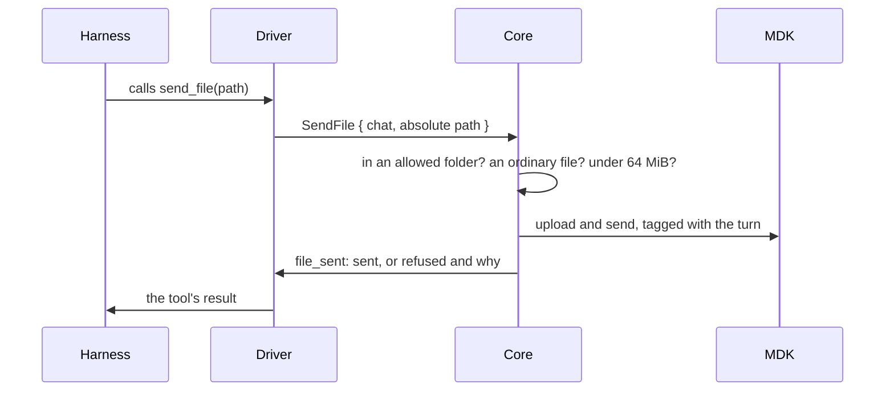

# Drivers

Status: draft. Which driver each harness gets is decided
([D-005](../decisions.md#d-005-which-driver-each-harness-gets)), and so is the preference for official
libraries ([D-006](../decisions.md#d-006-prefer-official-interfaces-and-libraries)), and so are the trait and
the capability flags ([D-058](../decisions.md#d-058-the-driver-trait-and-the-capability-flags)), and so is how
the Codex driver splits its work ([D-060](../decisions.md#d-060-a-codex-translator-follows-one-thread-and-the-transport-routes)).
So is how drivers are tested
([D-074](../decisions.md#d-074-every-driver-is-tested-by-replay-and-by-one-end-to-end-scenario)), and what the
Pi driver builds on ([D-086](../decisions.md#d-086-the-pi-driver-reads-pis-rpc-messages-with-types-of-its-own)).
That an agent's file goes to the chat as an attachment from an allowed folder is decided
([D-090](../decisions.md#d-090-an-agent-sends-a-file-as-an-encrypted-attachment-from-an-allowed-folder)); how a
driver asks for it, in [sending a file](#sending-a-file), is a proposal: built, and provisional until the
owner accepts it.

## What a driver does

A driver connects one harness to the core. It does two things:

1. **It speaks the harness's own interface.** It starts the harness, holds a two-way session open, and tracks
   the running turn and any requests the harness is waiting on.
2. **It translates.** Native events become [agent events](event-model.md). Answers and controls from the chat
   become native calls.

It does not decide who is allowed to do anything, and it does not touch Marmot. See
[`architecture.md`](architecture.md).

## The drivers

| Harness | Driver | Language | Interface it speaks | Builds on |
| --- | --- | --- | --- | --- |
| Codex | Native | Rust | `codex app-server`, JSON-RPC over stdio | Types of its own, with Codex's schema as the reference ([D-055](../decisions.md#d-055-the-codex-driver-reads-codexs-messages-with-types-of-its-own)) |
| Pi | Native | Rust | `pi --mode rpc`, JSON lines over stdio | Pi's records read as JSON in its own code, not `pi-codes` ([D-086](../decisions.md#d-086-the-pi-driver-reads-pis-rpc-messages-with-types-of-its-own)) |
| Goose | ACP, with a small Goose flavour | Rust | `goose acp` | `agent-client-protocol` |
| OpenCode | ACP | Rust | `opencode acp` | `agent-client-protocol` |
| Other ACP agents | ACP | Rust | Each agent's ACP command | `agent-client-protocol` |
| Claude Code | Native | TypeScript | The Claude Agent SDK | `@anthropic-ai/claude-agent-sdk` |
| Cursor | ACP | Rust | `cursor-agent acp` | `agent-client-protocol` ([D-080](../decisions.md#d-080-cursor-is-driven-through-acp)) |
| Hermes | Plugin | Python | Hermes's platform plugin interface | Hermes itself |
| OpenClaw | Plugin | TypeScript | OpenClaw's channel plugin interface | OpenClaw itself |

The facts behind each choice are in [`../reference/harness-interfaces.md`](../reference/harness-interfaces.md).

### Why some are native and some use ACP

The Agent Client Protocol (ACP) is an open standard that many harnesses speak. One ACP driver covers all of
them, so a new harness can be a line of configuration.

ACP's standard part covers what harnesses have in common. What makes a harness distinctive mostly travels in
harness-specific extensions, or is missing. So:

- **A harness gets a native driver** when it matters enough that losing features is not acceptable, or when its
  ACP support is poor. That is Codex, Claude Code and Pi.
- **Everything else uses the ACP driver.** Where a harness needs something the standard lacks, the ACP driver
  gets a small "flavour" for it, as Goose does for steering.

Because all drivers sit behind the same trait, a harness can move from ACP to a native driver later without any
change above the driver.

### Why Hermes and OpenClaw are plugins

Hermes and OpenClaw are not coding tools driven by one person. They are agent runtimes with their own idea of
users, channels and routing. ACP models one editor user per session, so it has no place for who sent a message
or which group it came from. Their own plugin interfaces do. Each plugin runs inside its runtime and connects to
the core over [the socket](socket-protocol.md).

### What Hermes can and cannot report

Recordings show that Hermes hands a platform formatted text, not tool events: a line such as "Running a
command" arrives through the same call as a reply. Only approvals and questions arrive in a structured form. So
the Hermes connector can report messages, notices, approvals and questions, and cannot report tool calls as
items without a change on the Hermes side. The plugin sends a line about a tool, like Hermes's heartbeats, as a
message in the commentary phase, which is how Hermes shows it on every platform (provisional). See
[`../reference/hermes-messages.md`](../reference/hermes-messages.md).

## The driver trait

Every Rust driver implements one trait. A first version exists as code, in
[`crates/marmot-agent-driver`](../../crates/marmot-agent-driver). It has the operations of
[the socket's driver section](socket-protocol.md#the-driver-section) and no others, because a program on the
socket does the same job as messages:

- say what the harness is, and what it can do (capabilities);
- take a prompt;
- take an answer to a waiting request;
- take a control: interrupt, new session, change a setting, or one of the harness's own actions;
- hand back the next agent event, or a file the agent asks to send, and hear how that file went
  ([sending a file](#sending-a-file)).

Three things a driver does are not operations of their own. A prompt goes to its chat's session, and names
one only to resume it, so opening and resuming one happen when a prompt arrives
([D-065](../decisions.md#d-065-a-prompt-names-a-session-only-to-resume-one)). A message sent during a turn is a prompt like any other, so there
is no "steer". And "new session" is a control.

It is decided ([D-058](../decisions.md#d-058-the-driver-trait-and-the-capability-flags)). The core waits for
every request to return
([D-066](../decisions.md#d-066-the-core-finishes-every-request-it-starts)).

## Sending a file

A proposal, built and provisional. What is decided is the outcome
([D-090](../decisions.md#d-090-an-agent-sends-a-file-as-an-encrypted-attachment-from-an-allowed-folder)): the
file goes to the chat as an ordinary encrypted attachment, tagged with its turn, and only from folders the
settings allow.



- **The harness asks with a tool the driver gives it.** Codex gets a dynamic tool, `send_file`, on every
  session the driver starts, and Codex keeps it when a session is resumed. Claude Code gets an in-process MCP
  server from the Agent SDK with the same tool, which Claude Code calls `mcp__marmot__send_file`. Both take one
  argument, `path`. The model is never asked to write a path into its answer, and nothing in its words is read
  as a request to send.
- **The driver hands the core a request.** `next_event` gives either an event or `SendFile`: the driver's own
  id for the request, the chat, and the path. The driver makes a relative path whole by putting its working
  folder in front, leaving any `..` for the core to follow; the core takes only an absolute one. The core answers through `file_sent`, with the result and, for a
  refusal, a reason and a sentence that names no path. The driver passes that back to the harness as the
  tool's result. On the socket this is the `send_file` request
  ([the messages, as built](socket-protocol.md#the-messages-as-built)).
- **The core decides.** It reads only from the folders `files_from` lists. By default that is the working
  folder of a harness the core runs (Codex, Pi, an ACP agent); a connector on the socket has none until the
  settings list one, since the core does not know its folder. The core opens each folder when it starts and
  follows a path from that open folder one part at a time, never letting the system follow a link: a link on
  the way is read and followed by its words by the same rule, so it may lead elsewhere inside but never out,
  and a `..` never climbs above the folder. A folder on the way swapped for a link meanwhile cannot lead out
  either. It also refuses a file with a second name (a hard link, which could be outside), anything but an
  ordinary file, an empty file, and one over 64 MiB, well under the 512 MiB MDK uploads in one piece.
- **Never the agent's own home.** Whatever the folders, the core refuses a file inside the account home, which
  holds the agent's keys ([D-099](../decisions.md#d-099-files-from-the-agents-own-home-are-refused-by-default-and-the-owner-may-allow-them)):
  one whose way from the allowed folder passes through the home, known by its device and inode however it is
  named or linked, or one in an allowed folder that lies inside the home. So a working folder of `~` lets the
  agent send its work but not its keys. A folder in `files_from` that is, holds or lies inside the home stops
  the core from starting. The owner may allow both with one line in the settings,
  `send_files_from_agent_home = true`. Whether an allowed folder lies inside the home is found from the
  folder held open, by going up from it; when the way up cannot be followed, the folder counts as inside.
  Known limit: a bind mount can show part of the home elsewhere, where the way up does not pass through the
  home, so a file reached through one is not refused. Telling that would mean reading the mount table.
- **Sending runs on the side.** Uploading can take long, so it runs as a task of its own while the chats go
  on, and the core tells the driver once it is done. The core offers the file to MDK again only while MDK says
  it is busy, which it says only before it has taken the file, for about half a minute. Any other failure is
  reported as `failed` and not tried again, since MDK may have sent the file anyway, and a post cannot be
  taken back.
- **What people see.** The file arrives as a chat message carrying the attachment and the turn's tag, as the
  agent's words do ([D-022](../decisions.md#d-022-the-agents-words-are-ordinary-chat-messages)), and alerts
  like an answer. The tool call shows as a `tool` item. A refused file shows as the core's refused notice
  ([D-077](../decisions.md#d-077-a-refused-notice-says-why-something-was-not-acted-on)), with the reason
  `not_allowed`, `invalid`, `not_supported`, `busy` or `failed`, and never the path
  ([D-071](../decisions.md#d-071-what-may-be-logged)).
- **Who may.** Calling the tool needs nobody's approval in the chat: the Claude Code connector allows it in
  its permission callback, and Codex does not ask for a dynamic tool. The folders are the limit, as the owner set them.

Pi, the ACP driver, and the Hermes and OpenClaw plugins do not offer the tool yet. A plugin would send the
same `send_file` request from its gateway's own message tool.

## Capabilities

Each driver declares what its harness can do: interrupt a turn, what it does with a message sent during one,
resume a session, take attachments, and so on. The core and the clients read these flags and never check a
harness's name. A driver states every flag; none is optional.

The flags, with what Codex states for each, are in
[D-058](../decisions.md#d-058-the-driver-trait-and-the-capability-flags).

## Testing with recorded sessions

Record a real session with a harness: every message in both directions. Replay it through the driver in a test
and check the agent events that come out. When a harness changes its interface, a new recording shows the
difference.

Hand-written test messages are a guess about what the harness sends. Recordings are what it sends.

The Codex driver is tested this way: each of its recordings must give the events the prototype gives
([`crates/marmot-agent-codex/tests/replay.rs`](../../crates/marmot-agent-codex/tests/replay.rs)). Every driver
is tested so, and by one end-to-end scenario
([D-074](../decisions.md#d-074-every-driver-is-tested-by-replay-and-by-one-end-to-end-scenario)). Every
driver also passes the [conformance suite](../../crates/marmot-agent-conformance/README.md), on a fake harness
that can fail in each way review found drivers mishandle.

## The Codex driver

It has two halves: a translator, which turns the messages of one chat's Codex session into agent events and
builds what the driver sends, and a transport, which runs `codex app-server` and gives each translator its own
thread's messages ([D-060](../decisions.md#d-060-a-codex-translator-follows-one-thread-and-the-transport-routes)).
A session starts in a working folder with a narrow sandbox unless configured otherwise
([D-061](../decisions.md#d-061-a-codex-session-starts-in-a-working-folder-with-a-safe-sandbox-unless-configured)),
Codex reads a group message with its sender's name
([D-062](../decisions.md#d-062-what-codex-reads-for-a-chat-message)), Codex keeps each session so it can be
resumed ([D-063](../decisions.md#d-063-codex-keeps-a-session-so-it-can-be-resumed)), and a form from an MCP
server is declined for now ([D-064](../decisions.md#d-064-the-codex-driver-declines-an-mcp-servers-form-until-forms-are-designed)). Both halves are written
([`crates/marmot-agent-codex`](../../crates/marmot-agent-codex)). The transport runs one Codex for every chat of an
agent, and starts it with subagents switched off until how a chat shows them is decided
([subagents as threads](subagents.md)). Every session it starts gets the driver's `send_file` tool
([sending a file](#sending-a-file)); a call becomes a `tool` item, of kind `other`, like any tool. A
request waits for Codex at most a minute in all, to read what the driver writes, to pick a session, or for a
request before it; a Codex that has not read or answered by then has stopped working, and the connection ends,
so nothing it says later is read and a message cut short is never finished
([D-066](../decisions.md#d-066-the-core-finishes-every-request-it-starts); found by the conformance suite's
`never_answers` and `stops_reading`, 2026-11-22).

## The Claude Code driver

A separate TypeScript program, [`packages/claude-code`](../../packages/claude-code), that runs Claude Code
through the official Claude Agent SDK (pinned exactly, at 0.3.326, which runs Claude Code 2.1.326) and connects
to the core over the [socket](socket-protocol.md#the-messages-as-built). The core is started with a
`[connector]` section in place of `[codex]`; then:

```sh
cd packages/claude-code
npm ci
node src/main.ts --home <agent home> --cwd <project folder> [--model <model>] [--permission-mode default]
```

It finds the socket and its token in the agent's home, and exits when the core closes the socket. It loads no
Claude Code settings files (the SDK's `settingSources` is empty,
[D-082](../decisions.md#d-082-the-claude-code-driver-loads-no-claude-code-settings-files)), so no allow rule or hook in the owner's own
Claude Code settings approves or runs anything in a chat; a side effect is that it reads no `CLAUDE.md` either.
It has the
same two halves as the Codex driver. The translator (`src/translate.ts`) turns one chat's Claude Code messages
into agent events and is tested against the recordings. The transport (`src/connector.ts`) runs one SDK
session per chat:

- A prompt starts the chat's session if none is running, resuming the one the core names
  ([D-065](../decisions.md#d-065-a-prompt-names-a-session-only-to-resume-one)), and goes in as a user message,
  written as for Codex ([D-062](../decisions.md#d-062-what-codex-reads-for-a-chat-message)). The next turn
  names the prompts sent since the last one. Only a fresh session takes `--model` and `--permission-mode`; a
  resumed one keeps the model and permission mode it last showed. If Claude Code stops in the middle of a
  turn, the turn ends cancelled and the next prompt resumes the session.
- An approval waits in Claude Code's `canUseTool` callback until the answer comes. "Allow once" allows the
  call as asked, a standing choice allows it with the rule Claude Code suggested, and the last choice denies.
  A question from `AskUserQuestion` is answered the same way.
- Interrupt calls `interrupt()`. New session closes the chat's SDK session, and the next prompt starts a
  fresh one. `set` changes the permission mode or the model.
- The event that shows an answer's or a control's effect names it
  ([D-028](../decisions.md#d-028-an-answer-or-a-control-is-a-request-and-the-agents-reply-settles-it)): the
  approval's next edit, the end of the interrupted turn, the session item's edit that shows the new setting
  (sent as soon as Claude Code takes it), or the end of the old session.
- An event too large for a line of the socket (4 MB) goes without its native message, and if it is still too
  large, with its longest texts cut in the middle until it fits. Its `prompts` and `settles` are kept.
- Every query gets the connector's `send_file` tool (`src/files.ts`), an in-process MCP server, which
  `canUseTool` allows without asking the chat. A call sends the core a `send_file` request and tells Claude Code what the core answered
  ([sending a file](#sending-a-file)). The core needs `files_from` in its settings for a connector, normally
  the folder given as `--cwd`.

Its capabilities: it can interrupt; a message sent during a turn ends the turn and starts another (`restart`,
[D-040](../decisions.md#d-040-a-message-sent-during-a-turn-goes-straight-to-the-harness)); the core names the
sessions, and they can be resumed; approvals come to the chat; no approval commands. It takes no files yet
(`files_in` is `none`, [D-083](../decisions.md#d-083-the-core-passes-no-files-to-a-harness-yet)): Claude Code reads images, and
passing them on is a later step.

## The ACP driver

Built into the core, in [`crates/marmot-agent-acp`](../../crates/marmot-agent-acp), with the same two halves as
the Codex driver. It reads ACP with the official types (`agent-client-protocol-schema`). The translator turns one
chat's ACP session into agent events and is tested against the OpenCode, Goose and Cursor recordings; the
transport runs one agent process for every chat of an agent, routes each message to the chat whose session it
names, and is tested against a stand-in agent. What each agent sends is in
[`reference/harness-messages.md`](../reference/harness-messages.md#acp-opencode).

The core is started with an `[acp]` section in place of `[codex]`:

```toml
[acp]
name = "opencode"                 # what events call the agent until it names itself; Cursor never does
command = ["opencode", "acp"]     # or ["cursor-agent", "acp"], or Goose's container, below
cwd = "/home/me/work"
```

- **Goose runs in a throwaway container.** `tools/goose/goose-acp.sh <model-key-file> [goose-home]` builds
  the image from [`tools/goose`](../../tools/goose/Dockerfile) (Goose pinned, with its checksum) and runs it
  with `docker run -i --rm`, speaking ACP on its standard input and output. The work folder is mounted at the
  same path, so the paths the core and Goose name agree; Goose's sessions live in `goose-home`, so they survive
  the container; the model key file is mounted read-only and never copied. The script refuses a work folder
  that holds `goose-home` or the key, or lies inside `goose-home`, or holds or lies inside the folder of every agent, which the installer names in `MARMOT_AGENT_DATA`,
  links resolved, and Docker keeps no log of
  the container, since what Goose writes holds the conversation. So the command is
  `["<repo>/tools/goose/goose-acp.sh", "<model-key-file>", "<goose-home>"]`, with the endpoint and the model
  in `MODEL_BASE_URL` and `MODEL_NAME` in its environment; neither has a default ([D-100](../decisions.md#d-100-the-installers-defaults)).
  Goose runs in its own default mode, `auto`, which asks nothing; `GOOSE_MODE=approve` makes it ask in the chat
  before every tool call.
- **OpenCode and Cursor run on the host.** Cursor uses the machine's own sign-in.
- **A prompt** starts the chat's session if it has none (`session/new`), or takes up the one the core names
  ([D-065](../decisions.md#d-065-a-prompt-names-a-session-only-to-resume-one)) with `session/resume` when the
  agent offers it and `session/load` otherwise; what `session/load` replays is not sent again. Goose, after taking up a
  session, carries on by itself with the turn a crash cut off, says so in `_meta.goose.activeRunId`, and
  refuses a prompt until it clears it; before every prompt, the driver cancels such a run, answers what it
  asks meanwhile as cancelled, and holds the prompt until Goose clears it, since a restart closes the turn
  ([D-070](../decisions.md#d-070-a-restart-closes-the-turn-as-interrupted)). Other agents are not waited for. The prompt
  is written as for Codex ([D-062](../decisions.md#d-062-what-codex-reads-for-a-chat-message)), as text only.
  A turn is named after the session and the prompt's request id; request ids start from the time, so a turn
  never takes the name of one from before a restart.
- **An approval** is answered with the option of the choice made; **a question** (an elicitation form) with
  the values of the options chosen, and typed text in the question's free-text field.
- **Interrupt** answers the requests still waiting as cancelled, as ACP asks, then sends `session/cancel`;
  until the turn ends, a request the agent makes is answered as cancelled at once. A message sent during a
  turn does the same, waits up to a minute for the turn to end, then prompts (`restart`). **New
  session** sends `session/new`, only when no turn is running. **`set`** sends `session/set_config_option`, and is settled by its reply, even one that changed nothing.
- **Item ids** of tools, approvals and questions name the session as well as the agent's tool-call id, which
  is the agent's own for one session; so an answer can only reach the chat whose request it names.
- **Writing**: each message goes whole to a task that writes it, so a call the core abandons never leaves
  half a message on the agent's input. A request returns only once its message is written, and only then
  is it fed to the chat's translator: an answer the agent can no longer read is refused as failed, not
  shown as given (found by the conformance suite's `answer_after_death`, 2026-11-22).
- **Waiting has a limit.** A session request, the end of a cancelled turn and the end of Goose's own run are
  each waited for up to a minute, and so is the writing of a request's message. A session request not
  answered, or a message not written, by then ends the connection: the task that writes ends with it, and
  nothing the agent says later is read, so a late reply cannot install a session after the prompt failed and
  a message cut short never reaches the agent (found by the conformance suite's `stops_reading`,
  2026-11-22).
- **Cursor's `cursor/update_todos`** names its tool call and no session; it goes to the chat whose session
  has that tool call.
- **Requests nobody is asked about** are answered at once: Cursor's `cursor/update_todos` is taken, anything
  else unknown is refused, so the agent never waits for ever.

Its capabilities: it can interrupt; a message during a turn restarts it; the core names the sessions, which
can be resumed when the agent can load or resume them; approvals come to the chat; no approval commands; no
files ([D-083](../decisions.md#d-083-the-core-passes-no-files-to-a-harness-yet)).

## The Pi driver

Built in, in [`crates/marmot-agent-pi`](../../crates/marmot-agent-pi), with the same two halves as the Codex
driver. The translator turns one Pi's records into agent events and is tested against
[the recordings](../../fixtures/recordings/README.md#pi); the transport runs Pi and implements the trait. The
core is started with a `[pi]` section in place of `[codex]`:

```toml
[pi]
cwd = "/home/me/work"
program = "tools/pi/pi.sh"           # or "pi", for a Pi installed on the machine
args = ["<model key file>", "<Pi's state folder>"]
```

- **One Pi per chat.** Pi in RPC mode holds one session at a time, so each chat gets its own Pi process,
  started as `program args… --mode rpc` in `cwd` when the chat first needs it. A session is resumed by
  starting Pi with `--session <id>`: when the core names one ([D-065](../decisions.md#d-065-a-prompt-names-a-session-only-to-resume-one)),
  and when the chat's Pi has stopped. Pi writes a session's file only once it holds a message, so a session
  that never did, such as a new one the core was restarted after, has none: then the driver starts Pi with
  `--session-id <id>`, which makes it again, empty, with the same id. A session the driver has seen hold a
  message is not made again if its file has gone; the prompt is refused. Before the first prompt the driver
  asks for the state, the models, the thinking levels and the commands, which the session item shows, and
  once, at start, for `pi --version`. Pi 1.6.0 reads nothing until its extensions' start-up handlers have
  finished, so a question one asks then could never be answered: the driver treats it as a failed start, as
  it does a Pi that has not answered within a minute or comes up in another session, and stops that Pi.
- **In a container.** [`tools/pi/pi.sh`](../../tools/pi/pi.sh) runs Pi in a throwaway Docker container built
  from [`tools/pi/Dockerfile`](../../tools/pi/Dockerfile), Pi pinned at 1.6.0, on standard input and output.
  The working folder is mounted at the same path, and the model key file from the first argument, read-only.
  `MODEL_BASE_URL` and `MODEL_NAME` name the endpoint and the model; neither has a default ([D-100](../decisions.md#d-100-the-installers-defaults)).
  Pi reads the key from that file when it calls the model, so it is in no image, environment variable or file
  Pi writes. Of Pi's state folder, the second argument, each chat's Pi gets only the chat's own folder, so it
  cannot read another chat's sessions: the driver names the chat in `MARMOT_AGENT_CHAT`, as a hash of its id.
  Since the working folder is mounted read-write, the script refuses to start if it holds the state folder or
  the key file, or lies inside the state folder, or holds or lies inside the folder of every agent, which the installer names in `MARMOT_AGENT_DATA`, links resolved.
  Asking Pi its version, whatever arguments come
  before `--version`, gets an empty state folder.
  Docker keeps no log of the container, since what Pi writes holds the conversation. When the driver stops a
  Pi, its standard input closes and the script gets SIGTERM, then SIGKILL after ten seconds; the script removes
  the container, so a command it was running is killed, and nothing after it runs. It waits for one Docker is
  still creating, and removes that too. A chat's container is named
  after the chat's state folder, so one left running when the core itself was killed outright is removed the
  next time that chat's Pi starts.
- **A turn** is a Pi run, from `agent_start` to `agent_settled`, so Pi's own retries and steered messages
  stay in it. Pi gives turns no id; the driver names one after the session and the timestamp of its first
  message.
- **A prompt** goes as Pi's `prompt` command, always with `streamingBehavior: steer`, written as for Codex
  ([D-062](../decisions.md#d-062-what-codex-reads-for-a-chat-message)). During a turn Pi delivers it after the
  running tool calls, before its next model call, in the same turn (`fold`). A slash command naming an
  extension's command runs at once and starts no turn. A request returns once its record is written to Pi,
  without waiting for Pi to respond: Pi responds to a prompt only after an extension's handler has finished,
  and the handler may be waiting for the chat's answer to a question. Pi's response, read in turn with its
  other records, says which turn responds to the prompt: the next one (`started`), the running one (`queued`),
  or none. If Pi refuses it, the error item that makes says so.
- **Interrupt** sends `abort`; the end of the turn settles it. **New session** sends `new_session`, and the new
  session item settles it. **`set`** changes `model` (`provider/id`) or `thinking`; the session item's edit
  settles it, made again if the setting kept its value, since Pi then says nothing. The one action,
  `compact`, is settled by the end of the compaction it asked for, not one Pi starts of its own accord; a
  second one while it runs is refused as busy, since Pi would abort the first. Pi's refusal of any of them, or an extension cancelling a
  new session, is an error item that settles it. If Pi stops before a control has had its effect, an error
  item the driver makes settles it as failed; the items the driver closes for a stopped Pi settle nothing.
- **Approvals.** Pi has none: it asks nobody before a tool runs, so `approvals` is no. An extension can ask
  through Pi's extension UI. A `select`, `confirm`, `input` or `editor` request becomes a question item,
  answered by the label chosen or the text typed; `notify` becomes a notice. With Pi's example permission
  gate loaded (`--extension …/permission-gate.ts` in `args`), a dangerous command asks the chat first.

Its capabilities: it can interrupt; a message sent during a turn folds into it; the core names the sessions,
and they can be resumed; no approvals; no files (`files_in` is `none`, provisional: Pi takes images, and
passing them on is a later step); no approval commands.

## The OpenClaw plugin

A channel plugin named `marmot`, in TypeScript, that runs inside OpenClaw
([`packages/openclaw`](../../packages/openclaw)) and connects to the core over the
[socket](socket-protocol.md#the-messages-as-built). It is built as JavaScript and installed into OpenClaw from a
packed archive, as a release is. OpenClaw runs in a container, never on the owner's machine directly:

```sh
packages/openclaw/run.sh <agent home> <openclaw state folder> <work folder> <model-key-file> [model]
```

The script builds the image from [`container/Dockerfile`](../../packages/openclaw/container/Dockerfile)
(OpenClaw pinned at 2026.11.5) and runs it as the calling user, with the core's socket folder, the token
(read-only), OpenClaw's state folder, the work folder and the model key (read-only) mounted. A Unix socket works
across the mount. Started with the core, the script waits for its socket, and refuses a work folder that holds
the agent's home, the state folder or the key, or lies inside the home or the state folder, or holds or lies
inside the folder of every agent, which the installer names in `MARMOT_AGENT_DATA`, links resolved. Docker keeps no log of the container, and of the gateway's output only the
plugin's own fixed messages, which name what happened by kind, reach the script's standard error
([D-071](../decisions.md#d-071-what-may-be-logged)). The container is named after the state folder, so Docker runs one at a time on it, and the
entrypoint may then recover the lock that a killed gateway leaves on OpenClaw's state, which OpenClaw cannot do
by itself across containers. `MODEL_BASE_URL` names the endpoint and `MODEL_NAME`, or `[model]`, the model;
neither has a default ([D-100](../decisions.md#d-100-the-installers-defaults)). `MODEL_FALLBACKS` may name models OpenClaw tries when the first fails. The core is started with a `[connector]` section, as for Claude Code. The key stays out of the
image and out of the configuration file, and the plugin replaces its whole value with a marker in anything it
sends. The masked form `/model status` shows is let through
([D-088](../decisions.md#d-088-openclaws-model-status-may-show-the-masked-model-key)).

It has the same two halves as the other drivers. The translator (`src/translate.ts`) is a port of the
prototype's OpenClaw rules and is tested against the recordings. The transport (`src/connector.ts`, and
`src/index.ts`, the one file that touches OpenClaw's plugin SDK) does what the recorder in
[`tools/record/openclaw`](../../tools/record/README.md#openclaw) does, and writes down every call the same way, so
the translator reads in use what it was tested on:

- **A prompt** goes through OpenClaw's own receive path: the route, the verdict on the sender, the context and
  the run. Each chat is a group to OpenClaw, so each has its own session; OpenClaw puts every direct chat in
  one session otherwise. A reply carries the id and the quoted text. The turn that the run starts names the
  prompt. A message sent during a turn waits, and runs as a turn of its own (`queue`).
- **Who may prompt and approve is the core's** ([D-084](../decisions.md#d-084-the-core-decides-first-and-a-gateway-allows-what-the-core-lets-through)).
  The plugin hands OpenClaw an open policy for whatever the core sends. It claims OpenClaw's approval
  capability, so each approval arrives with its fields, and when OpenClaw asks whether a sender may approve, it
  says yes only for a sender the core has vouched for: one whose answer to that approval the core sent, or
  whose typed `/approve` the core checked against the right to approve. The container sets no OpenClaw owner
  and switches `/bash` off.
- **An answer** to an approval is a press, through OpenClaw's approval gateway, as the person who answered. A
  question takes one option, the same way; an answer in words is refused for now.
- **A control is typed**, as OpenClaw takes it, from the person who sent it: interrupt is `/stop`, new session
  is `/new`, and `set` is `/model <provider/model>` or `/think <level>`. A `set` is settled when its own
  command is over: by the session's edit if the stored entry now shows the value, otherwise by OpenClaw's
  answer, such as a refusal or a value already in use, or by a notice the plugin makes when OpenClaw dropped
  the command with no answer. Other settings are refused.
- **A new session keeps OpenClaw's session key and id**, so the plugin counts sessions under each key (the
  second is `key#2`) and keeps the count in OpenClaw's state folder, so a restart does not bring back a
  session that ended. An id the translator makes up from a count carries a mark of the plugin's start, so it
  is never used for another item.
- **When the socket closes**, the core has already ended the turns on it. The plugin cancels the runs it
  started through that connection, starts none for a message still on its way, and waits for every run to
  end before it connects again, however long that takes, so an old run never shares a session with a new
  one. Until then the core cannot reach the agent.
- **The session item lists OpenClaw's commands and the models** the agent may use, asked for through the
  plugin SDK when a chat first reaches OpenClaw, as the recorder asks for them.
- **The agent's message tool is offered no actions**, until the socket's chat section is designed.

Its capabilities: it can interrupt; a message sent during a turn waits (`queue`); OpenClaw picks the sessions
(`own`), and they outlive a restart, in its state folder; approvals come to the chat; no files yet. Its
approval commands are `/approve`, `/exec`, `/elevated` and `/elev` anywhere in a message, and `/config`,
`/debug`, `/bash`, `!`, `/allowlist`, `/acp`, `/codex`, `/mcp` and `/plugins` at the start. All of this is
provisional, for the owner's review.

## The Hermes plugin

A Hermes platform plugin in Python, [`python/marmot_hermes`](../../python/marmot_hermes), that runs inside
Hermes and connects to the core over the [socket](socket-protocol.md#the-messages-as-built). It uses the
standard library and what Hermes provides, nothing else. Hermes sees a chat platform called `marmot`. The core
is started with a `[connector]` section, as for Claude Code, and Hermes runs in a container:

```sh
docker volume create hermes-home
python/hermes/run.sh <agent home> <work folder> hermes-home <model key file> [model]
```

The image ([`python/hermes/Dockerfile`](../../python/hermes/Dockerfile)) holds Hermes at a pinned commit and
the plugin. Only the core's socket folder and the plugin's token are mounted from the agent's home, never the
rest of it, and Hermes runs as the user that owns them; the script waits for the core's socket, and refuses a
work folder that holds the agent's home or the key, or lies inside the home, or holds or lies inside the folder of every agent, which the installer names in `MARMOT_AGENT_DATA`,
links resolved. The image is built for that user and group, so its tag names them
(`marmot-agents-hermes-<uid>-<gid>`). Hermes's own home is a Docker volume, so its sessions survive a restart;
the installer names it, and the container, after the agent and a hash of its folder, since Docker's names are
shared by every account on the machine. `MODEL_BASE_URL` names the endpoint and `MODEL_NAME`, or `[model]`,
the model; neither has a default ([D-100](../decisions.md#d-100-the-installers-defaults)). The model key is mounted read-only and read at every start
into Hermes's environment, which its configuration names (`key_env`); it is written into no file, the volume
included, and Hermes keeps that variable from the commands it runs. Hermes's own output holds what people and the model say, so neither `run.sh` nor Docker keeps any
of it (`--log-driver=none`). With `HERMES_LOG` the plugin appends its own log lines to that file, mounted
for it alone; they name what went wrong by kind only ([D-071](../decisions.md#d-071-what-may-be-logged)).

It has the same two halves as the other drivers. The translator (`translate.py`) turns one chat's Hermes calls
into agent events and is tested against the recordings. The transport (`connector.py`, with `adapter.py` for
the part that needs Hermes) records every call Hermes makes on the platform as a line, exactly as the recorder
does, and feeds it to the chat's translator:

- A prompt is handed to Hermes as a chat message from its sender, in its chat, with the quoted text and author
  of a reply. Hermes keeps its own sessions, one for each chat and sender (`sessions: own`); a session the core
  names is not used. The plugin names a session after the chat and the sender, and counts when Hermes replaces
  it; the count is kept in Hermes's home, so a replaced session's name never comes back after a restart.
  Because a group has a session for each sender, two senders' turns can overlap: an approval, a question, the
  end of a turn and a reply go to the turn whose session or message they name, and Hermes's other lines, which
  name neither, to the latest turn.
- An approval arrives as Hermes's approval card, because the plugin claims approval buttons, and is answered
  on the card with the choice Hermes offered, by the card's request id. A question is answered through the
  call Hermes gives a platform for it, by the question's id, and is closed only once Hermes has taken the
  answer. A request to confirm a typed command is answered by typing the answer, as a person would.
- For Hermes a control is a typed command. Interrupt types `/stop` in the turn's chat as its sender, new
  session types `/new`, and setting the model types `/model <id>`, after which the plugin asks Hermes for the
  session's model. No other setting can be changed from the chat yet. A session's name gives its sender, so
  after a restart too a new session is asked for as the sender whose session it is.
- The event that shows an answer's or a control's effect names it: the approval's or question's next edit,
  the end of the interrupted turn, the end of the old session once Hermes has replaced it (or the new session,
  when the old one was not shown since the plugin started), or the session item that shows the new model.
  When Hermes refuses `/new` or `/model`, the request is refused with what Hermes said.
- The session item lists Hermes's commands, read once from Hermes's command registry, and the session's model,
  asked for once in each session.
- Hermes can report a turn complete and start it again a moment later, for the first message of a session. The
  end of a turn that showed nothing is held for 10 seconds, and dropped if the turn starts again. Until then
  the turn still counts as running, so it can be interrupted.
- When Hermes restarts after a crash cut a turn off, it pauses that session: the next message is saved, and
  Hermes asks for `/discard`, which drops the lost turn without running it again, or `/reset`. The core has
  already closed that turn as interrupted
  ([D-070](../decisions.md#d-070-a-restart-closes-the-turn-as-interrupted)), so the plugin sends `/discard`
  itself, and the saved message is answered (provisional). In a container this takes up to five minutes more:
  Hermes keeps a lease on a session's turn, stamped with the process's PID namespace, and a new container
  cannot tell that the old holder is gone, so it waits for the lease to run out.

The core decides who may prompt and approve, as for every harness
([D-084](../decisions.md#d-084-the-core-decides-first-and-a-gateway-allows-what-the-core-lets-through)), and
Hermes is set up to take whatever reaches it: every user is allowed, anyone in a chat may answer an approval,
and `/new` is not confirmed a second time. Provisionally, Hermes's approval mode is `manual`, so a command
Hermes flags is always put to a person, never decided by a second model.

Its capabilities: it can interrupt; a message sent during a turn is folded into it (`fold`); Hermes keeps its
own sessions, and they survive a restart; approvals come to the chat; it takes no files yet. Its approval
commands, each counted at the start of a message, are `/approve`, `/deny`, `/yolo`, `/approvals`, `/memory`,
`/skills` and `/codex-runtime`.

## Adding a harness

1. **Does it speak ACP well?** Add it as a configuration entry for the ACP driver.
2. **Does it need something ACP lacks?** Add a flavour to the ACP driver for that one thing.
3. **Does it matter enough, or is its ACP support poor?** Write a native driver: in Rust if the interface is a
   documented wire protocol, or as a separate program over the socket if the official library is in another
   language.
4. **Is it a runtime with its own users and channels?** Write a plugin for it that connects over the socket.
