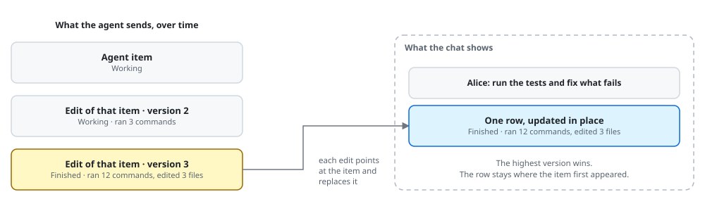

# How an agent event is carried

Status: proposal. Nothing on this page is decided. It answers part of
[Q-01](../open-questions.md#q-01-what-exactly-is-in-an-agent-event) and
[Q-02](../open-questions.md#q-02-what-happens-to-large-output), and it needs agreement in the Marmot
specification ([Q-03](../open-questions.md#q-03-where-are-the-event-kinds-specified)). The decisions it asks for
are listed [at the end](#decisions-this-asks-for).

[The event model](event-model.md) says what an agent event means: ten item types, each with a state. This page
says how one travels through a Marmot group: what kind of event it is, what it contains, and how an item that
changes is updated.

## What the carrier has to do

1. **Let an item change.** A tool call is sent when it starts and again when it finishes. The chat must show one
   row that updates, not two rows.
2. **Stay readable everywhere.** A client that knows nothing about agents should still show something sensible.
3. **Stay small enough.** Tool output can be large, and every event is stored on every member's devices.
4. **Alert people only when they are needed.** An approval that is waiting should reach a phone. A tool call
   should not.

## What Marmot gives us today

Read from the Marmot specification at commit `162c61b` and MDK at `a2d3486ac`, both on 2026-11-17.

| Fact | Consequence |
| --- | --- |
| An app event is an unsigned Nostr-shaped event: `kind`, `content`, `tags`, `created_at`, `pubkey`, and an `id` computed from them. The sender is proven by the group's encryption, not by a signature | An agent event is one of these; nothing new is needed underneath |
| The list of kinds is not a gate. A client must accept an event of a kind it does not know, and may choose not to show it | A new kind is allowed |
| Kinds 1201 and 1202 are reserved for agent activity, with no definition yet | They are the obvious numbers to use |
| The only way one event changes another is an edit (kind 1009), and it only replaces the text of a chat message, by the same author | There is no general "this replaces that". We have to define one |
| MDK gives every 1201 and 1202 event its own row | Sent as they are today, a tool call that starts and finishes would show twice |
| `created_at` counts whole seconds, and nothing numbers an author's events | Several agent events in one second have no defined order |
| Files and images travel as attachments on chat messages (kind 9) only | A large output cannot be attached to an agent event as things stand |
| Nothing is short-lived except live previews over the separate QUIC channel | Every agent event sent is kept as history |
| The spec sets no size limit on an app event | We have to choose one |

## The proposal

### 1. The agent's words are ordinary chat messages

What the agent says to people is sent as a normal chat message, kind 9, exactly as a person's message is. It
carries one extra tag that names the turn it belongs to.

Every client already shows these, and replies, reactions, search and alerts work without anyone doing anything.
An app that knows about agents can use the tag to group the message with the rest of its turn.

### 2. Everything else is one new kind: an agent item

Turns, tool calls, approvals, questions, plans, tasks, notices, errors and reasoning are all sent as one kind of
event. The item's type is a tag inside it, not a different kind.

One kind keeps the rule for updates in one place, and gives old clients one thing to ignore.

### 3. An item is updated by sending it again, whole

<picture>
  <source media="(prefers-color-scheme: dark)" srcset="../images/carrier-dark.svg">
  
</picture>

Every agent item has an **item id** and a **version**. To change an item, the agent sends the whole item again
with the same id and a higher version.

- **The highest version wins.** A client shows only that one. If two events claim the same version, the later
  `created_at` wins, and then the higher event id, so every client picks the same one.
- **The row stays where the first version appeared.** The chat does not jump around as items update.
- **Only the agent that created an item can update it.** The author must be the same account.
- **Each version is complete.** A client that missed an earlier version loses nothing.

This is the same idea as the events our prototype already produces: each one replaces the earlier state of its
item. In the recordings, most items are sent once or twice.

### 4. What an agent item contains

| Part | Where | Example |
| --- | --- | --- |
| The plain rendering | `content` | `Ran a command: python3 greet.py (exit 0)` |
| Item id and version | a tag | `cmd-7`, `2` |
| Item type, and kind of tool | a tag | `tool`, `command` |
| State | a tag | `done` |
| Turn and session | tags | |
| Position within the turn | a tag | `6` |
| Harness and its version | a tag | `codex`, `0.169.0` |
| The message that started the turn | an `e` tag, as replies use | |
| The type's own fields | a tag holding JSON | the command, exit code, output |
| The harness's native message | a tag holding JSON | |

The plain rendering goes in `content` because that is the part of an event every client can read. A client that
does not know this kind, but shows unknown events as text, shows something a person can understand.

### 5. A number gives the order within a turn

Each agent item carries its position within its turn: 1, 2, 3. Clients order a turn's items by it.

Without it, order is undefined. `created_at` counts whole seconds, and an agent often produces several items in
one second. MDK would then fall back to ordering by event id, which is effectively random.

## Size

Tool output is the part that can be large. These are sizes from four days of one developer's real use of Claude
Code; lengths only were measured, never content.

| | Typical | 9 in 10 are under | 99 in 100 are under | Largest |
| --- | --- | --- | --- | --- |
| A tool's output | 0.8 KB | 6 KB | 19 KB | 56 KB |
| A tool's input | 0.3 KB | 1.3 KB | 6 KB | 51 KB |
| A piece of the agent's text | 0.1 KB | 1 KB | 7 KB | 31 KB |
| A piece of reasoning | 0.3 KB | 0.9 KB | 3 KB | 13 KB |

Proposed rule: **an agent item is at most 16 KB.** That carries about 98.6% of tool outputs whole.

When an item would be larger, the driver drops parts in this order and says so in the event:

1. the native message is left out, with its size noted;
2. the output is cut, keeping the start and the end, with the full length noted.

Getting the full output afterwards is a separate problem: fetch it from the agent on request, or attach it as a
file. Attachments exist only for chat messages today, so that needs work in the spec. It is the same question as
an agent sending a file ([Q-23](../open-questions.md#q-23-how-does-an-agent-send-a-file-to-the-chat)).

## Who gets alerted

The agent decides, per event, whether it should alert people:

| Event | Alert? |
| --- | --- |
| The agent's final answer | Yes, as any chat message does |
| An approval or a question that is waiting | Yes |
| A turn that failed | Yes |
| Everything else: tool calls, reasoning, plans, tasks, notices, a turn starting or finishing normally | No |

MDK already treats 1201 and 1202 as their own class of event that triggers no alert, so "no" is today's
behaviour. The waiting approval is the case that needs adding. It matters because Codex and Claude Code wait for
an answer with no time limit.

Whether the agent's remarks during a turn ("I'll run the tests now") should alert like a final answer is open.

## The summary line

A turn is itself an item, so it can be updated in place. That gives the summary line from
[the detail-level proposal](../open-questions.md#a-proposal-for-q-11-and-q-12-not-decided) with no extra
mechanism: the turn item's text becomes "Working · ran 3 commands", then "Finished · ran 12 commands, edited 3
files", each a new version of the same item.

At a lower detail level, the agent would send only the turn item and not each tool call. How many versions of it
to send, and how often, is part of that product question.

## What older apps show

- **The agent's words:** shown normally, because they are chat messages.
- **Agent items:** an app built on today's MDK shows each version as its own generic row, so an updated item
  appears more than once. An app that hides unknown kinds shows nothing.

The White Noise apps are ours and would be updated together with this. Other Marmot clients would see the
agent's words and little else until they add support.

## Options considered

| Option | Why not |
| --- | --- |
| Send every item as a chat message and update it with an edit | Edits replace only the text, so state and structured fields could not change. Every tool call would also alert people and clutter clients that do not know about agents |
| Send only what changed in each update | Smaller, but a client that misses one update shows the wrong thing from then on. Whole items are safe to miss |
| A separate kind for each item type | Ten kinds to register and ten places to repeat the update rule, for no gain a tag does not give |
| Leave the agent's words in the new kind too | Clients that do not know the kind would show nothing of what the agent said |

## What it needs from the spec and from MDK

In the Marmot specification:

- the agent item kind: its tags, the update rule, the size limit, and what a client that does not support it
  should do;
- the turn tag on chat messages.

In MDK:

- build and read agent items;
- keep one row per item id and author, holding the latest version;
- order a turn's items by their position number;
- decide alerts by item type and state;
- expose the result to the apps.

This is the part of the design that MDK keeps
([D-001](../decisions.md#d-001-connectors-live-in-this-repository)).

## Not covered here

**Answers and controls.** What a person's app sends back, such as "allow once" or "interrupt", is the next piece.
It will reference an item by its id.

## Decisions this asks for

1. Are the agent's words ordinary chat messages, with everything else in a new kind?
2. Is an item updated by sending it again whole, with the highest version winning?
3. Is it one kind for all item types?
4. Are 1201 and 1202 the kinds to use, defined in the Marmot specification?
5. Is 16 KB the limit, with the native message dropped first and the output cut second?
6. Is the alert rule right: final answers, waiting approvals and questions, and failed turns?
