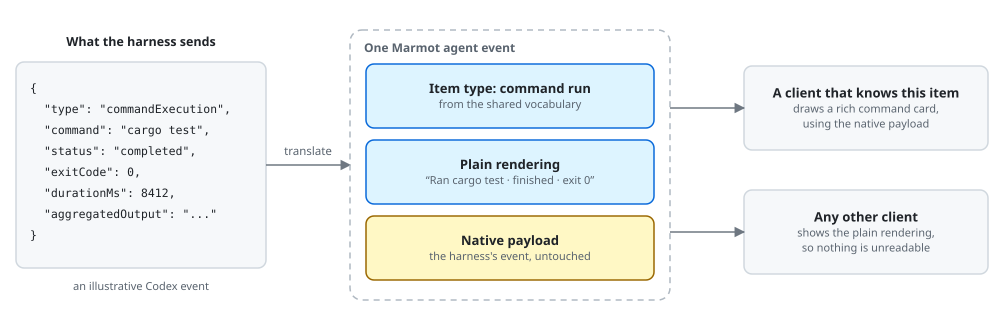

# The event model

Status: draft. The principles are decided
([D-007](../decisions.md#d-007-one-shared-event-vocabulary),
[D-008](../decisions.md#d-008-pass-everything-through)). The item list, the fields and every number on this page
are proposals. They have been checked once against real Codex and Claude Code sessions; see
[Checked against real sessions](#checked-against-real-sessions). The open points are
[Q-01 to Q-04](../open-questions.md#the-event-model).

This is the most important design in the project. Every driver produces these events and every client draws
them.

## The idea

A harness emits its own events in its own format. A driver turns each one into a **Marmot agent event** with
three parts.

<picture>
  <source media="(prefers-color-scheme: dark)" srcset="../images/event-dark.svg">
  
</picture>

| Part | What it is | Who uses it |
| --- | --- | --- |
| Item type | One of a small shared list: message, tool call, plan and so on | Clients, to choose how to draw it |
| Plain rendering | A title, some text and a status | Any client, including one that does not know the item type |
| Native payload | The harness's own event, unchanged | Clients that want to show more for a harness they know |

Marmot chat already works this way for ordinary messages: people send unsigned Nostr-shaped events of kinds that
clients know how to render. Agent events extend that set.

## Proposed item types

Two independent projects arrive at nearly the same list: the Agent Client Protocol, and T3 Code's internal event
model. That agreement is the best evidence available of what is common to all harnesses. See
[`../reference/prior-art.md`](../reference/prior-art.md).

| Item | What it shows |
| --- | --- |
| Message | Text the agent says to the people in the chat |
| Reasoning | The agent's thinking |
| Plan | The agent's plan or to-do list, with the state of each entry |
| Tool call | A tool the agent used, its input, its state and its result |
| Command run | A shell command, its output and exit code |
| File change | An edit, with its diff |
| Search | A web or file search and what it found |
| Approval request | The agent wants permission for one action, with the choices offered |
| Question | The agent asks the person something, with any choices offered |
| Subagent | Work the agent handed to another agent |
| Background task | Work that keeps running after the turn that started it, with its progress and outcome |
| Notice | Compaction, a mode or model change, a warning, the agent waiting |
| Error | Something failed |
| Turn | A turn started or ended, with how it ended and any usage figures |

Command run, file change and search are kinds of tool call that are common enough to draw specially. A tool that
fits none of them is a plain tool call.

An item can change over time: a tool call starts, then finishes. The proposal is that a later event for the same
item replaces the earlier one, so a client always draws the latest state.

## Proposed envelope

Every agent event carries the same surrounding fields, whatever its item type.

| Field | Purpose |
| --- | --- |
| Harness name and version | Lets a client pick a richer view for a harness it knows |
| Session | Which harness session this belongs to |
| Turn | Which turn within the session |
| Item id | Stable for the life of the item, so updates replace earlier states |
| Parent | The message that started the turn, or the item this one belongs to |
| Sequence | Order within the turn |
| Item type | From the list above |
| Plain rendering | Title, text, status |
| Native payload | The harness's event, unchanged, within a size limit |

## Answers and controls

People act on the agent in two ways.

**Answers** respond to something the agent asked: an approval request or a question. An answer is a message that
names the exact request it answers and the choice made. The choice is an opaque id that the harness supplied; the
client does not need to know what it means.

**Controls** are things a person does unprompted: interrupt, steer, start or resume a session, switch model or
mode, run a slash command.

Proposed rules, which come from the earlier approvals design
([Q-04](../open-questions.md#q-04-what-carries-over-from-the-earlier-approvals-design)):

- An answer counts only if it names the exact request and comes from someone allowed to approve.
- Ordinary text such as "yes" or "go ahead" is never treated as an answer.
- Answers and controls go to the core and the driver. They are never passed to the model as a prompt.
- A request can be answered once. Later answers are ignored.

## Checked against real sessions

The proposals above were compared with 26 recorded sessions and with the structure of 176,652 messages from
real use. The detail is in [`../reference/harness-messages.md`](../reference/harness-messages.md); the
recordings are in [`fixtures/recordings`](../../fixtures/recordings/README.md).

**What held up**

- **Items with stable ids.** Both harnesses give each piece of work an id and report it when it starts and when
  it finishes. An event that replaces the earlier state of the same item fits both.
- **Almost every item on the list.** Messages, reasoning, commands, file changes, tool calls, approval requests,
  questions, subagents, errors and turns all appear, in one form or another, in both.
- **Choices supplied by the harness.** Codex sends a list of decisions with each approval request.

**What has to change**

| Finding | Change to the proposal |
| --- | --- |
| Background tasks are common in real use and had no item | A background task item is added to the list above |
| Codex offers an object, not a string, as one of its decisions | The driver gives every choice its own id and keeps the native value. A choice id on the wire is never the native value |
| Codex accepted a decision that was not in its own list | The driver may add choices the harness accepts but did not list, such as "decline" |
| Codex can ask a question as a field on an ordinary message, with nothing to answer | A question says how it is answered: by an answer to the request, or by the person's next message |
| Claude Code's question can hold several questions and allow several selections | A question item holds a list of questions, each single or multiple choice |
| Steering stays in the turn for Codex and ends the turn for Claude Code | "Steer" is a request the core makes; what happens to the turn is the driver's to report |
| Claude Code produced a whole turn after a background task finished, with no prompt | A turn records what started it: a person's message, or the agent itself |
| An interrupted Codex command never reported finishing | When a turn ends, the driver closes every item still open |
| Half of all traffic is partial text, and much of the rest is bookkeeping | Each driver states which native messages are never sent |
| Claude Code does not say whether a tool call is a command, an edit or a search | The driver decides from the tool's name; an unknown tool is a plain tool call |

**What is still unchecked**

Neither harness produced a plan in these sessions, so the plan item is untested. Resuming a session, Codex's
question request, compaction, attachments and failures have not been recorded yet. The list is at the end of
[`fixtures/recordings/README.md`](../../fixtures/recordings/README.md#not-recorded-yet).

**A number for volume**

In one developer's real use, a turn averaged about 12 tool calls, 7 reasoning blocks and 3.5 pieces of text.
If each tool call is sent when it starts and again when it finishes, that is roughly 35 events per turn. See
[Q-12](../open-questions.md#q-12-how-many-events-is-too-many).

## What is deliberately not in the model

- **The meaning of a choice.** "Allow once" and "Allow for this session" are the harness's concepts. The event
  carries the harness's choices as given.
- **Guarantees about what the harness did.** An answer was delivered to the harness. What happened next arrives
  as the harness's own later events.
- **Layout.** There are no cards, columns or styling instructions. Clients decide how each item looks.
