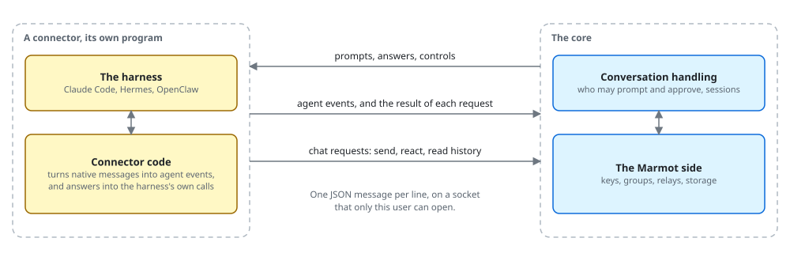

# The socket protocol

Status: draft. Decided: there is a local socket
([D-003](../decisions.md#d-003-the-boundary-to-other-languages-is-a-local-socket)), and it speaks
`marmot.agent-control.v3` with a hello, a driver section and a chat section, no live preview stream, and no
support for v2 ([D-020](../decisions.md#d-020-the-socket-speaks-agent-control-v3-with-a-clean-cutover)).
Also decided, on 2026-11-18: the framing, what the core does for every connector, one connection per agent,
the ids a connector sees, how often a prompt is delivered, and the credential
([D-033](../decisions.md#d-033-the-sockets-framing-is-json-rpc-20-one-message-per-line) to
[D-038](../decisions.md#d-038-each-connector-has-its-own-token)). They are listed [at the end](#what-was-decided).

The core speaks the driver section now, with the fields in [the messages, as built](#the-messages-as-built):
the trait's shapes ([D-058](../decisions.md#d-058-the-driver-trait-and-the-capability-flags)), accepted at the
end of M2 ([D-081](../decisions.md#d-081-the-socket-messages-as-built-are-accepted)). One request of the chat
section, `send_file`, is built and is a proposal until the owner accepts it. Not designed: the other requests of
the chat section ([Q-32](../open-questions.md#q-32-what-does-the-sockets-chat-section-carry)), and
administration ([Q-05](../open-questions.md#q-05-how-is-the-agent-administered)).

Every message as built is described exactly by a JSON Schema made from the core's own types,
[`fixtures/socket/schema.json`](../../fixtures/socket/schema.json), with an example of each in
[`examples.json`](../../fixtures/socket/examples.json) beside it. They are generated and checked, not
designed: the core's tests fail when they fall behind its types, and each connector's tests check it against
them. They add nothing to this page; where the two seem to differ, the schema is what the core does.

## What it is for

Some connectors cannot be compiled into the core, because the harness's interface exists only in another
language. They run as their own programs and talk to the core over a socket on the same machine.

| Program | Language | Why it is separate |
| --- | --- | --- |
| Claude Code driver | TypeScript | Built on the official Claude Agent SDK |
| Hermes [channel plugin](drivers.md#channel-plugins) | Python | Must run inside Hermes |
| OpenClaw [channel plugin](drivers.md#channel-plugins) | TypeScript | Must run inside OpenClaw |
| Third-party connectors, later | Any | [D-014](../decisions.md#d-014-outside-developers-can-write-connectors-later) |

## The principle

<picture>
  <source media="(prefers-color-scheme: dark)" srcset="../images/socket-dark.svg">
  
</picture>

A program on the socket is a driver. It does over the socket exactly what a built-in driver does through the
Rust trait: it sends agent events up and receives prompts, answers and controls down. The core treats both the
same.

A program on the socket never sees keys, ciphertext, relays or group state. It also never sees an event kind
or a tag. It speaks in the terms of [the event model](event-model.md), and the core turns that into Marmot
events.

## What the core does, so that no connector has to

Decided as [D-034](../decisions.md#d-034-the-core-does-the-shared-work-and-a-connector-speaks-only-in-agent-events).

| Job | Why it belongs in the core |
| --- | --- |
| Check who may prompt and who may approve | One place for the owner's rules ([D-010](../decisions.md#d-010-the-owner-sets-who-may-prompt-and-who-may-approve)). Everything a connector receives is already allowed |
| Tell a person who was refused | Hermes drops a disallowed sender silently, and D-010 wants them told |
| Decide whether a group message is for this agent | A connector receives only messages that are |
| Turn an agent event into a chat message, an agent item or an edit | [D-022](../decisions.md#d-022-the-agents-words-are-ordinary-chat-messages), [D-023](../decisions.md#d-023-one-kind-carries-every-agent-item), [D-025](../decisions.md#d-025-an-agent-item-is-updated-with-an-edit) |
| Number the items in a turn and the versions of an item | |
| Apply the size limit | [D-026](../decisions.md#d-026-an-agent-item-is-at-most-64-kb), [D-057](../decisions.md#d-057-the-core-applies-the-64-kb-limit) |
| Decide who is alerted | [D-024](../decisions.md#d-024-who-an-agent-event-alerts) |
| Report the result of an answer or a control to the chat | [Answers and controls](answers-and-controls.md#3-the-agents-reply-is-what-counts) |
| Close open items when a connector goes away | A harness that is killed sends nothing |

## Framing

[JSON-RPC 2.0](https://www.jsonrpc.org/specification), one message per line, over a Unix socket
([D-033](../decisions.md#d-033-the-sockets-framing-is-json-rpc-20-one-message-per-line)).

v2 already puts one JSON message per line on a Unix socket, which is easy to write from any language and easy
to record for tests. v3 keeps that and adds JSON-RPC's three message shapes: a request with an id, a response
that carries the same id, and a notification that expects no response. Either side can send a request. Codex's
app server and ACP use the same framing, so libraries exist in every language we need.

A message is at most 4 MB. A connector cuts anything larger before sending it.

Windows has not been looked at.

## The hello

A connection opens with one request from the connector.

| Field | Meaning |
| --- | --- |
| `protocol` | `marmot.agent-control.v3` |
| `connector` | Its name and release version |
| `harness` | The harness's name and version |
| `token` | The credential. See [who may connect](#who-may-connect) |
| `capabilities` | What the harness can do. See [capabilities](#capabilities) |

The core replies with its own version and the agent's display name. It refuses a protocol it does not speak
with an error that names the one it does. Drivers that run as separate programs can fall behind the core
([issue 11](https://github.com/marmot-protocol/marmot-agents/issues/11)), and this makes that easy to see. A
change a connector must follow changes the protocol's name; the core reads the connector's own version but does
not check it, since no release of a connector is too old for it yet.

**One connection is one agent.** The token decides which. Each harness install is its own agent
([D-035](../decisions.md#d-035-each-harness-install-is-its-own-identity-with-its-own-sessions)).

## The driver section

### From the core to the connector

Three requests. Each gets a response as soon as the connector has taken it or refused it. What the harness then
does arrives as agent events.

| Request | Carries |
| --- | --- |
| `prompt` | The message's id and text. The chat: an id, whether it is a group, its name. The sender: an id and a name. For a reply: the id of the message replied to, its text and its author. Attachments, each as a path to a file the core wrote, with a name and a type. The session, only when the core resumes one ([D-065](../decisions.md#d-065-a-prompt-names-a-session-only-to-resume-one)) |
| `answer` | The item being answered, who answered, and the choices: ids the item offered, and text where the question allows it. One answer can cover several questions |
| `control` | The action, what it acts on, who sent it, and the action's details. See [answers and controls](answers-and-controls.md#5-controls-a-few-shared-ones-and-whatever-the-harness-offers) |

A connector may refuse with one of these reasons: `not_supported`, `busy`, `unknown_item`, `not_waiting`,
`already_answered`, `nothing_to_do`, `invalid`, `failed`. The core turns a refusal into the notice the chat
sees.

This section is behind the Rust trait, which is decided
([D-058](../decisions.md#d-058-the-driver-trait-and-the-capability-flags)). There, each answer and control
carries an id the core makes up, an event names the requests it settles and the chat it belongs to, and an
answer gives one choice to an approval or one entry for each question. The socket takes the same shapes: see
[the messages, as built](#the-messages-as-built).

Why each part of a prompt is there:

- **The sender and the chat, on every prompt.** Hermes and OpenClaw route a prompt inside their own runtime.
  Hermes keeps one session per sender, even in a group. OpenClaw keeps one per group.
- **The quoted text and its author, for a reply.** Hermes cannot look a message up. OpenClaw could answer from
  the id alone, and takes the quote when it is given.
- **The message's id.** A gateway's own message tools act on it, for example to react to it.

**Ids are the core's own** ([D-036](../decisions.md#d-036-the-ids-a-connector-sees-are-the-cores-own)). A chat's id and a
sender's id are stable values the core makes up for this install. They are not the group's id or the person's public key. A gateway keeps its own logs and transcripts,
and nothing in them should identify a group or a person to anyone else. Names are passed as they are, because
the model needs them.

### From the connector to the core

One notification, `event`, with no response. It is an agent event as [the event model](event-model.md) defines
it.

| Field | Meaning |
| --- | --- |
| `item` | The connector's own id for the item. The same id again means the item changed, so an id is never reused for another item, also after the connector reconnects |
| `type`, `state` | One of the item types, and its state |
| `title`, `text` | The plain rendering |
| `body` | The type's own fields |
| `native` | The harness's own message |
| `session`, `turn` | The session and the turn it belongs to |
| `prompts` | On a turn: the ids of the messages it responds to |

Rules:

- **Whole items only.** An event repeats the entire item. There is no "text so far"
  ([D-012](../decisions.md#d-012-word-by-word-streaming-is-not-required-now)).
- **Order is the order sent.** The core numbers items as they arrive.
- **The first event of an item creates it. A later one edits it.** The connector does not need to know which.
- **Send everything, at full size.** The core applies the size limit.
- **Typing signals and bookkeeping are never sent.** They are a third to four fifths of what a gateway emits.

## The chat section

Hermes and OpenClaw give their agents message tools, so an agent can act in the chat on its own initiative. The
chat section is requests from the connector to the core: send, edit and delete a message, add and remove a
reaction, send a file, and read history.

What an agent may do is decided
([D-042](../decisions.md#d-042-an-agent-may-act-in-its-own-chat-and-may-not-change-a-group-or-the-account)):

- It may send a message, edit or delete a message of its own, add and remove a reaction, and read history.
- It may do so only in the chat its session belongs to, with the ids the core gave it.
- It may not change a group or the account: no renaming, creating groups, inviting or removing people. That
  waits for [administration](#administration).

These are ordinary Marmot actions. A delete is an ordinary deletion of a chat message, and the tool call that
caused it still arrives as a `tool` item.

An agent's file goes to the chat as an encrypted attachment, only from folders the settings allow
([D-090](../decisions.md#d-090-an-agent-sends-a-file-as-an-encrypted-attachment-from-an-allowed-folder)). The
request for it, `send_file`, is built as a proposal: see [the messages, as built](#the-messages-as-built) and
[sending a file](drivers.md#sending-a-file). The other requests are not designed yet.

## Capabilities

The connector states in the hello what its harness can do. The core and the apps read these and never check a
harness's name. They are the seven flags of
[D-058](../decisions.md#d-058-the-driver-trait-and-the-capability-flags), every one, every time; what each
harness states was drawn from the recordings. The Hermes column is what the Hermes plugin states; its `resume`
was seen in its scenario, where Hermes went on in the same session after a crash.

| Capability | Values | Codex | Claude Code | Hermes | OpenClaw |
| --- | --- | --- | --- | --- | --- |
| `interrupt` | yes or no | Yes | Yes | Yes | Yes |
| `mid_turn`: what happens to a prompt during a turn | `fold`, `restart`, `queue` | `fold` | `restart` | `fold` | `queue` |
| `sessions`: who picks the session | `core` or `own` | `core` | `core` | `own` | `own` |
| `resume`: a session survives a restart | yes or no | Yes | Yes | Yes | Yes, in its state folder |
| `approvals` | yes or no | Yes | Yes | Yes | Yes, if the owner switched forwarding on |
| `files_in`: attachments on a prompt | `none`, `images` or `any` | `images` | `images` | `none`, for now | `none`, for now |
| `approval_commands`: typed commands that need the right to approve | a list; each entry says whether it counts anywhere in a message or only at the start | None | None | `/approve`, `/deny`, `/yolo`, `/approvals`, `/memory`, `/skills`, `/codex-runtime`, each at the start | `/approve`, `/exec` anywhere in a message, `/elevated` and more |

`approval_commands` exists because Hermes and OpenClaw accept an approval typed as a message. A typed message
is a prompt, and needs only the right to prompt. So the core checks a message that starts with one of these
commands against the right to approve ([D-032](../decisions.md#d-032-every-action-needs-one-of-two-rights)). A command
that changes the harness's permission mode belongs on the list too. Both gateways have several, and OpenClaw
honours one of them anywhere in a message, so each entry says where it counts
([D-047](../decisions.md#d-047-a-listed-command-says-where-in-a-message-it-counts)). The full lists are in
[answers and controls](answers-and-controls.md#typed-commands-that-widen-what-an-agent-may-do).

Codex is a built-in driver and does not use the socket. It is in the table because the same facts about each
harness apply to the Rust trait, whose flags are the seven in D-058, not the rows of this draft.

## When things go wrong

| What happens | What the core does |
| --- | --- |
| The connection drops during a turn | Closes the turn and every open item, with the reason. The chat shows the turn as interrupted |
| The connector comes back | Takes a new hello. Nothing is replayed. A connector that outlived the connection, as a gateway's plugin does, starts from what the new core knows: it sends nothing more of the items that were open, and names none of the requests the old core settled |
| The connector has not taken a request after 30 seconds | Refuses it as failed and gives the connector up, as for a drop. So a connector answers once its harness has the request, never once its effect shows |
| The connector stops reading, so the core cannot write a request, or another line, within 30 seconds | Gives the connector up, as above. A prompt of which part was written is reported as perhaps not delivered ([D-138](../decisions.md#d-138-a-connector-that-stops-reading-is-given-up-in-a-requests-time)) |
| What the core holds for the connector while it waits for its answer, the lines it sent meanwhile and the refusals it owes for repeated `send_file` ids together, would pass 32 MB | Gives the connector up at once, as above, and keeps nothing of the line that would pass it. The events it sent until then still reach the chat; a file it asked for meanwhile is not sent, and the chat is told so ([D-145](../decisions.md#d-145-the-core-bounds-what-it-holds-for-a-connector-and-the-files-it-sends-at-once)) |
| The connection drops while the core hands on what was stored meanwhile | Hands nothing more to it. The next connector is given the messages that were never tried, each once ([D-139](../decisions.md#d-139-prompts-a-driver-that-ended-was-never-given-wait-for-the-next-driver)) |
| A prompt is handed to a connection already gone, and none of it is written | Tells nobody, and hands nothing more to it. The next connector is given the prompt, once ([D-180](../decisions.md#d-180-a-prompt-a-driver-refuses-as-having-ended-waits-for-the-next-driver-whenever-the-core-handed-it-on)) |
| A prompt was sent and no response came before the drop | Reports it as perhaps not delivered: the harness may have it ([D-129](../decisions.md#d-129-a-prompt-whose-answer-a-dropped-connection-lost-is-told-as-perhaps-not-delivered)). It is never sent again |
| An event that settles the request waited on, or a turn of the prompt's chat that names the prompt, came before the drop and the response | Counts the request as taken: the event settles it, once ([D-147](../decisions.md#d-147-a-request-whose-effect-a-connector-showed-before-its-connection-dropped-was-taken)) |
| An answer or a control was taken and nothing settled it before the drop | Settles it with a notice that it failed ([D-058](../decisions.md#d-058-the-driver-trait-and-the-capability-flags)) |
| An event names an unknown turn or session | Accepts it. A harness can produce work outside a turn |
| A message is not valid | Answers with an error and keeps the connection |

A prompt is delivered at most once ([D-037](../decisions.md#d-037-a-prompt-is-delivered-at-most-once)). Running a prompt
twice is worse than losing one, because the person can see a prompt that was lost and send it again. The rest
of what happens on a restart is in
[D-070](../decisions.md#d-070-a-restart-closes-the-turn-as-interrupted).

## Who may connect

Decided as [D-038](../decisions.md#d-038-each-connector-has-its-own-token), as enough for now:

- The socket is in a folder that only the owner's user account can open.
- Each connector has its own token, in a file only that user can read. The core creates it when the owner adds
  the connector. The token says which agent the connector drives, and that it is a connector and not an
  administrator.
- Administration needs a different token.

What this gives and does not give: it stops other users of the machine, it tells connectors apart, and it keeps
a connector from using administration by accident. It does not stop a program running as the same user, which
can read the token files and the core's own data. A harness with a shell runs as that user. Real separation
needs the core to run as a different user, which is possible later and not planned now.

## An example

Alice asks for a command to be run, and allows it. `→` is from the core, `←` from the connector. Fields are
shortened.

```text
← {"id":1,"method":"hello","params":{"protocol":"marmot.agent-control.v3","connector":{"name":"claude","version":"0.1.0"},"harness":{"name":"claude-code","version":"2.1"},"token":"…","capabilities":{…}}}
→ {"id":1,"result":{"core":{"version":"0.1.0"},"agent":{"name":"Claude on the laptop"}}}

→ {"id":7,"method":"prompt","params":{"message":"m-31","text":"run the tests","chat":{"id":"c-2","group":true,"name":"Family"},"sender":{"id":"u-1","name":"Alice"}}}
← {"id":7,"result":{}}
← {"method":"event","params":{"item":"turn-4","type":"turn","state":"running","title":"Working","prompts":["m-31"]}}
← {"method":"event","params":{"item":"cmd-9","type":"tool","state":"running","title":"Running a command","text":"cargo test","turn":"turn-4"}}
← {"method":"event","params":{"item":"ap-2","type":"approval","state":"waiting","title":"Allow this command?","body":{"subject":"cmd-9","choices":[{"id":"once","label":"Allow once","effect":"allow"},{"id":"deny","label":"Deny","effect":"deny"}]},"turn":"turn-4"}}

→ {"id":8,"method":"answer","params":{"item":"ap-2","by":{"id":"u-1","name":"Alice"},"given":{"choice":"once"}}}
← {"id":8,"result":{}}
← {"method":"event","params":{"item":"ap-2","type":"approval","state":"done","text":"Answered: Allow once","turn":"turn-4"}}
← {"method":"event","params":{"item":"cmd-9","type":"tool","state":"done","title":"Ran a command","body":{"exit_code":0},"turn":"turn-4"}}
← {"method":"event","params":{"item":"msg-5","type":"message","state":"done","text":"All 42 tests pass.","turn":"turn-4"}}
← {"method":"event","params":{"item":"turn-4","type":"turn","state":"done","title":"Finished"}}
```

In the chat this is one message from the agent, and three rows that each updated in place.

## The messages, as built

What `crates/marmot-agent/src/socket.rs` sends and reads, through the types in
[`socket/wire.rs`](../../crates/marmot-agent/src/socket/wire.rs). Every field of every message is in
[the schema](../../fixtures/socket/schema.json), and every message has an example in
[`examples.json`](../../fixtures/socket/examples.json). Decided at the end of M2
([D-081](../decisions.md#d-081-the-socket-messages-as-built-are-accepted)). The socket is `socket/marmot-agent.sock` in the agent's home, in a folder only the owner can open, and the
token is `connector.token` there, which the core writes the first time ([D-038](../decisions.md#d-038-each-connector-has-its-own-token)).

**The hello**, the connector's first request:

```json
{"jsonrpc": "2.0", "id": 1, "method": "hello", "params": {
  "protocol": "marmot.agent-control.v3",
  "connector": {"name": "claude-code", "version": "0.1.0"},
  "harness": {"name": "claude-code", "version": "2.1.326"},
  "token": "…",
  "capabilities": {"interrupt": true, "mid_turn": "restart", "sessions": "core", "resume": true,
                   "approvals": true, "files_in": "images", "approval_commands": []}}}
```

The seven flags of D-058, every one. A connector whose harness works in a folder a chat may move adds
`"folder": "/home/me/work"`, a whole path, beside `capabilities`: where the harness works when a chat chose
none ([D-101](../decisions.md#d-101-a-chat-can-move-a-coding-harness-to-another-folder); provisional, added
2026-11-22). One that leaves it out, as a gateway's plugin does, is offered no folder setting. A connector whose
harness tells its subagents apart adds `"subagents": true` to `capabilities`, and names the subagent each event
belongs to in the event's `subagent` field; one that leaves it out says no, and its events are shown in the main
chat ([D-142](../decisions.md#d-142-how-subagent-threads-are-built); provisional, added 2026-11-24). One that can
stop one subagent, and those it started, while the turn goes on adds `"stop_subagent": true`, and is then sent
an `interrupt` naming that subagent's `task` item as `subagent` for a Stop in its thread; one that leaves it out
is sent the turn alone, and stops it all ([D-149](../decisions.md#d-149-stop-in-a-subagents-thread-stops-that-subagent-alone);
provisional, added 2026-11-24). The core answers `{"core": {"version"}, "agent": {"name"}}`, or an error:
`-32001` for another protocol version, `-32002` for a token that is not this agent's, `-32600` or `-32602` for a
hello it cannot read, such as a `folder` that is not a whole path.

**`prompt`**: `message`, `text`, `chat` (`id`, `group`, `name`, and `folder` when the chat chose one),
`sender` (`id`, `name`), `attachments` (`path`, `name`, `media_type`), and when there are any, `reply_to`
(`message`, `text`, `author`) and `session`. `folder` is a whole path, links resolved: the connector starts
the chat's next session there, and leaves a running one where it is (provisional, D-101).

**`answer`**: `request`, `item`, `by` (`id`, `name`) and `given`: `{"choice": <id>}` for an approval, or
`{"questions": [{"question", "options", "text"}]}`.

**`control`**: `request`, `by` and `action`, by `type`: `interrupt` (`turn`, and `subagent` for a Stop of one
subagent), `new_session` (`chat`,
`session`), `set` (`session`, `setting`, `value`), `own` (`session`, `id`). A `set` of the core's own
`folder` setting never reaches a connector: the core turns it into a `new_session` whose `chat` names the
new folder (provisional, D-101).

A connector answers each with `{}` once it has taken it, or with an error whose `data` holds a `reason` (one of
the eight words above) and, if it likes, a `detail` for the chat.

**`event`**, a notification: an agent event as `marmot-agent-events` writes it (`item`, `type`, `state`,
`title`, `text`, `body`, and `session`, `turn` and `native` when there are any), with three more fields: `chat`,
the chat it belongs to; `prompts`, on a turn; and `settles`, the requests whose effect it shows. The connector
leaves out `harness` and `seq`: the core fills them in, numbering each session's events on from the last
number it kept for the session, so a session that goes on across connections never numbers a later event
before an earlier one. The core passes over a field its types do not know,
so it never reaches the chat; the schema admits none, so a connector's tests catch one. The connectors here
send none.

**`send_file`**, a request from the connector, provisional: the agent sends a file to the chat.

```json
{"jsonrpc": "2.0", "id": 7, "method": "send_file", "params": {"chat": "c-1", "path": "/home/me/work/report.pdf"}}
```

`chat` is the core's id for the chat; `path` is absolute. The core answers once the file is sent, with `{}`, or
with an error whose `data` holds a `reason` and a `detail` for the agent, which names no path:
`{"code": -32000, "message": "not_allowed", "data": {"reason": "not_allowed", "detail": "The file is outside the
folders the agent may send files from."}}`. The reasons are the eight above and `not_allowed`, which only the
core gives. The answer can take as long as the upload; the connector's id is its own, numbered after the hello.
A second `send_file` with the id of one still unanswered is refused as `invalid` and nothing is sent.
The core uploads two files at once and holds 16 at most; one more is refused as `busy` at once. When the
connection goes, a file still waiting is never offered to MDK, and the chat is told it was not sent; an upload
under way is stopped, and since MDK may already have taken its file, which can still reach the chat, the chat is
told nothing of it. The connector is told about neither
([D-145](../decisions.md#d-145-the-core-bounds-what-it-holds-for-a-connector-and-the-files-it-sends-at-once)).
The protocol version stays `marmot.agent-control.v3`: a connector that never sends the request is unchanged.

## What it replaces

MDK's `wn-agent` daemon speaks `marmot.agent-control.v2`: one JSON message per line over a Unix socket. It has
54 request types, most of them about chat messages, account management and maintenance. Agent activity is a
small corner of it.

v3 turns that around. Agent events and controls are the centre.

There is no bridge between the two. Every client of v2 is ours, so the connectors move to v3 in one cutover.

| In v2 | In v3 |
| --- | --- |
| Chat requests: send, edit, delete, react, media, history | The chat section |
| Agent activity and operation events | The driver section, in full |
| Live preview stream, seven requests | Left out until streaming is decided |
| Account, profile, relay lists, allow-list, invite policy, maintenance, diagnostics | Not available to connectors; see below |
| Debug requests | Not carried over |
| An authentication token in every message | Authentication once, in the hello |

## Administration

Open: [Q-05](../open-questions.md#q-05-how-is-the-agent-administered).

In v2 any connected client can administer the agent: change who may invite it, publish its profile, edit its
relay lists. In v3 a connector cannot. The harness is the thing being controlled, and it should not be able to
change the rules about who controls it.

The proposal is that the owner administers the agent through a configuration file and the core's own
command line, and later from the chat. The command line still has to reach the running core, so v3 gets an
administration section that only the owner's tools may use. Its messages are not designed here.

## What was decided

| Point | Decision |
| --- | --- |
| The framing is JSON-RPC 2.0, one message per line | [D-033](../decisions.md#d-033-the-sockets-framing-is-json-rpc-20-one-message-per-line) |
| The core does the jobs listed above, and a connector speaks only in agent events | [D-034](../decisions.md#d-034-the-core-does-the-shared-work-and-a-connector-speaks-only-in-agent-events) |
| One connection is one agent, chosen by the token | [D-035](../decisions.md#d-035-each-harness-install-is-its-own-identity-with-its-own-sessions) |
| Chat and sender ids are the core's own | [D-036](../decisions.md#d-036-the-ids-a-connector-sees-are-the-cores-own) |
| A prompt is delivered at most once | [D-037](../decisions.md#d-037-a-prompt-is-delivered-at-most-once) |
| A typed command that approves is checked against the right to approve | [D-032](../decisions.md#d-032-every-action-needs-one-of-two-rights) |
| A token per connector is enough for now, with its limit stated | [D-038](../decisions.md#d-038-each-connector-has-its-own-token) |
| A message sent during a turn goes straight to the harness, which is what `mid_turn` reports | [D-040](../decisions.md#d-040-a-message-sent-during-a-turn-goes-straight-to-the-harness) |
| What an agent may do through the chat section | [D-042](../decisions.md#d-042-an-agent-may-act-in-its-own-chat-and-may-not-change-a-group-or-the-account) |
