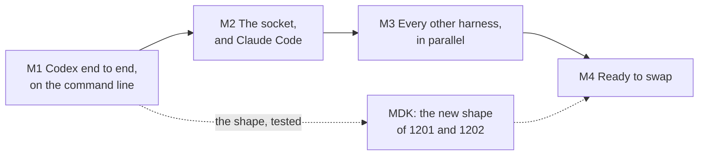

# The plan

Status: the working plan from 2026-11-21
([D-068](decisions.md#d-068-work-follows-the-plan-and-the-builder-decides-what-is-internal)). The goal, the
milestones and their order are decided. What is inside each milestone is the current best guess, and changes
as the work shows what it needs.

## The goal

Replace the agent connectors in MDK with what this repository builds, as soon as possible, with the shortest
time in which both run side by side. Prove on the way that the new model works better than today's: one core,
a driver per harness, and agent activity as durable items that are edited as they change.

## What has to be true for the swap

- **Every harness MDK connects today has a replacement here**: Claude Code, Codex, OpenCode, Pi, Goose, Hermes
  and OpenClaw. Cursor is new.
- **Nothing that works today is lost**: a separate identity per connector, the invite allow-list, outbound
  media read only from allowed folders, sends that are not repeated after a crash, catching up on messages
  missed while offline, installers, and an agent sending a file to the chat
  ([what must not be lost](reference/current-connectors.md#things-the-new-design-must-not-lose)).
- **An existing install moves over** keeping its identity, its keys, its encryption state and its groups
  ([D-089](decisions.md#d-089-an-install-moves-over-by-importing-its-account-home-in-place)).
- **MDK carries the new shape of kinds 1201 and 1202**, and its old connector code is deleted.

## Milestones

### M1: Codex end to end, on the command line

Done on 2026-11-21: the scenario passes against a real Codex, and a trial by hand with the test client worked.

The core runs for real: a person in a Marmot group on a local relay talks to Codex through it, from a terminal.
No app is involved, and MDK is used as it is today.

- **The core, `marmot-agent`.** One agent identity per process
  ([D-072](decisions.md#d-072-one-agent-identity-per-core-process-until-the-swap)), set up by a configuration
  file ([D-073](decisions.md#d-073-standing-settings-live-in-a-configuration-file)). It holds the account through
  MDK, joins a group only when the inviter is allowed, turns a chat message into a prompt when the sender may
  prompt (in a group, only when the agent is mentioned or replied to,
  [D-075](decisions.md#d-075-in-a-group-the-agent-answers-when-mentioned-or-replied-to-in-a-direct-chat-always)), and an answer or control into a request when the sender has the right. It keeps each chat's session
  and the items still open across restarts, applies the 64 KB limit, and settles each request once.
- **The carrier, for now.** MDK refuses kinds 1201 and 1202 from programs, and applies an edit only to a chat
  message or a comment. So until MDK takes the new shape, an agent item travels under a temporary kind, and an
  update travels as a new event with the item's id and a higher version
  ([D-069](decisions.md#d-069-until-mdk-takes-the-new-shape-agent-items-travel-under-a-temporary-kind)). The
  agent's words are chat messages, as decided. Switching to 1201, 1202 and edits is one change in one place.
- **A test client, `marmot-agent-chat`.** A terminal program that plays the person: it makes an account and a
  group, invites the agent, sends messages, shows each item as it changes, answers approvals and questions, and
  sends controls. How it shows each item type is a reference for the apps.
- **One scenario, scripted.** On a local relay, with a real Codex: invite the agent, prompt it, watch its
  commands and edits arrive, approve one, interrupt a turn, start a new session, restart the core mid-turn and
  carry on, with nothing run twice
  ([D-070](decisions.md#d-070-a-restart-closes-the-turn-as-interrupted),
  [D-074](decisions.md#d-074-every-driver-is-tested-by-replay-and-by-one-end-to-end-scenario)).

**Done when** the scenario passes, and the project owner has tried it by hand in the test client. What M1 shows
about the shape is written up as the specification of the new 1201 and 1202, for MDK to build.

### M2: The socket, and Claude Code

Done on 2026-11-21: the same scenario passes against a real Claude Code, through the socket.

The local socket, with the fields of each message fixed from what Claude Code needs, and the Claude Code driver
in TypeScript on the official SDK. **Done when** the same scenario passes with Claude Code.

### M3: Every other harness, in parallel

Pi (built in, Rust), the ACP driver for Goose, OpenCode and Cursor (built in, Rust,
[D-080](decisions.md#d-080-cursor-is-driven-through-acp)), and the
Hermes (Python) and OpenClaw (TypeScript) plugins. Each follows the Codex pattern: record scripted sessions,
write the translation against the recordings, then the part that runs the harness, then the scenario. They are
independent, so separate agents build them at the same time. Whose rules govern Hermes and OpenClaw is
decided: the core decides first ([D-084](decisions.md#d-084-the-core-decides-first-and-a-gateway-allows-what-the-core-lets-through)).
**Done when** the scenario passes for each.

Done on 2026-11-21: the scenario passes against a real Pi, OpenCode, Goose, Cursor, OpenClaw and Hermes. Pi,
Goose, OpenClaw and Hermes ran in throwaway containers on free models; OpenCode and Cursor on this machine. Cursor
goes through the ACP driver ([D-080](decisions.md#d-080-cursor-is-driven-through-acp)), and Pi's driver reads
Pi's messages itself ([D-086](decisions.md#d-086-the-pi-driver-reads-pis-rpc-messages-with-types-of-its-own)).
Known gaps are issues #63, #64 and #68.

### M4: Ready to swap

Everything on the list above that M1 to M3 did not already do: moving installs over (`marmot-agent import`,
built: [how](move.md)), installers and releases,
an agent sending a file ([D-090](decisions.md#d-090-an-agent-sends-a-file-as-an-encrypted-attachment-from-an-allowed-folder)), sends that
survive a crash, catching up after being offline, and the switch to MDK's 1201 and 1202 once MDK has them.
Also before the swap: a chat can move a coding harness to another folder
([D-101](decisions.md#d-101-a-chat-can-move-a-coding-harness-to-another-folder)), and the installers connect to the
harness the person already has, on Linux and macOS
([D-102](decisions.md#d-102-the-installers-connect-to-the-harness-the-person-already-has)).
**Done when** an install of each of today's connectors has moved over, on a test machine, without being
invited again, and every harness that allows it can send a file.

Built so far, provisional until the owner accepts what others can see:

- **An agent sending a file.** A driver asks the core to send a file, and the core sends it from an allowed
  folder as an encrypted attachment tagged with its turn. Codex and Claude Code each get a `send_file` tool;
  connectors on the socket send a `send_file` request. See
  [sending a file](design/drivers.md#sending-a-file) and
  [the socket's `send_file`](design/socket-protocol.md#the-messages-as-built). Pi and the ACP agents, and the
  Hermes and OpenClaw plugins, do not offer it yet; every harness that allows it must before the swap
  ([D-107](decisions.md#d-107-every-harness-that-lets-an-agent-send-a-file-gets-file-sending-before-the-swap)).

### Verification, alongside M4

The layers of [the verification page](design/verification.md)
([D-093](decisions.md#d-093-the-core-and-the-drivers-are-verified-in-layers-with-tla-models-at-the-top)), in its
order: fix the known gaps, each with a failing test; the simulator and the `CoreLifecycle` model; the driver
conformance suite; property tests, Kani proofs and fuzzing; trace validation, mutation testing and the nightly
lanes. Pull-request CI stays under 15 minutes
([D-094](decisions.md#d-094-ci-on-a-pull-request-stays-under-15-minutes-and-the-rest-runs-nightly)). **Done when**
every property on that page has an owner that runs in CI, and each model's unfair configuration finds its
counterexample.

## Outside this repository

These are the project owner's to arrange. This repository does not change MDK.

| When | What | Where |
| --- | --- | --- |
| Now | Remove the QUIC preview stack ([D-067](decisions.md#d-067-the-quic-preview-stack-is-removed)) | MDK, the Marmot specification, the apps |
| After M1 | Kinds 1201 and 1202 in the new shape: items with versioned edits, answers and controls, who is alerted. The specification comes from here | MDK, the Marmot specification |
| After that | White Noise shows agent items ([Q-20](open-questions.md#q-20-what-do-the-apps-need)) | The apps |
| At the swap | Delete the old connectors, their installers and their release workflows | MDK |

## Not before the swap

Each of these is wanted, and none is needed to replace what runs today: subagents as threads
([Q-30](open-questions.md#q-30-how-does-a-chat-show-an-agents-subagents)), how much detail a chat gets
([Q-11, Q-12](open-questions.md#q-11-what-keeps-sensitive-output-from-spreading)), going back to an older
session, changing permissions from the chat
([Q-10](open-questions.md#q-10-how-are-permissions-changed-from-the-chat)), several identities in one program
([Q-08](open-questions.md#q-08-how-do-several-agent-identities-run-together)), fetching output that was cut
([Q-02](open-questions.md#q-02-what-happens-to-large-output)), turns started by local tools
([Q-25](open-questions.md#q-25-can-something-outside-the-chat-and-the-harness-start-a-turn)), and signed
releases with automatic updates ([Q-28](open-questions.md#q-28-how-does-someone-know-a-release-is-genuine)).

## How the work runs

Set out in [D-068](decisions.md#d-068-work-follows-the-plan-and-the-builder-decides-what-is-internal). In
short: this plan is the go-ahead, so work moves from one milestone to the next without asking at each step. The
builder decides what is internal and can be changed later. What other programs, apps or people see, privacy and
security, who may do what, and any change to a decision go to the project owner, together, once per milestone,
each with a recommendation. Meanwhile the work carries on with the recommendation, marked as provisional.
